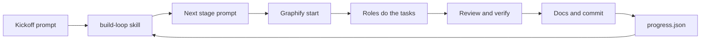
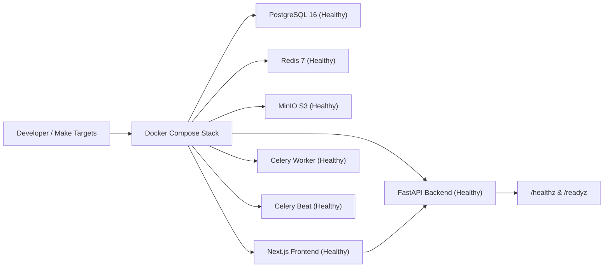
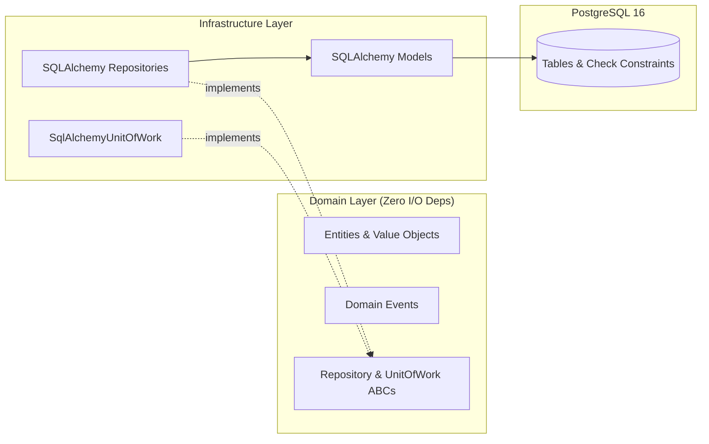
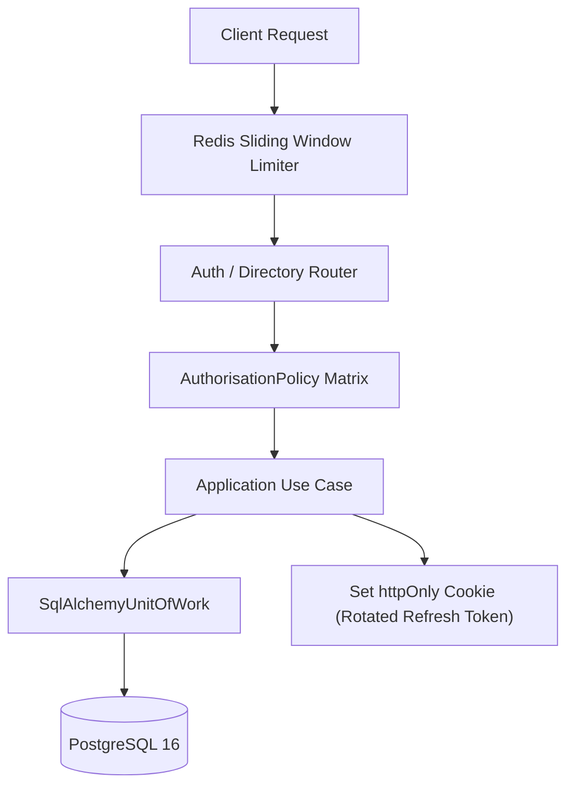
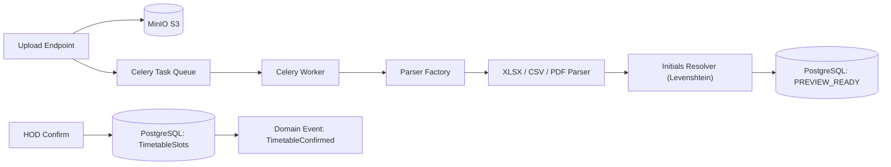
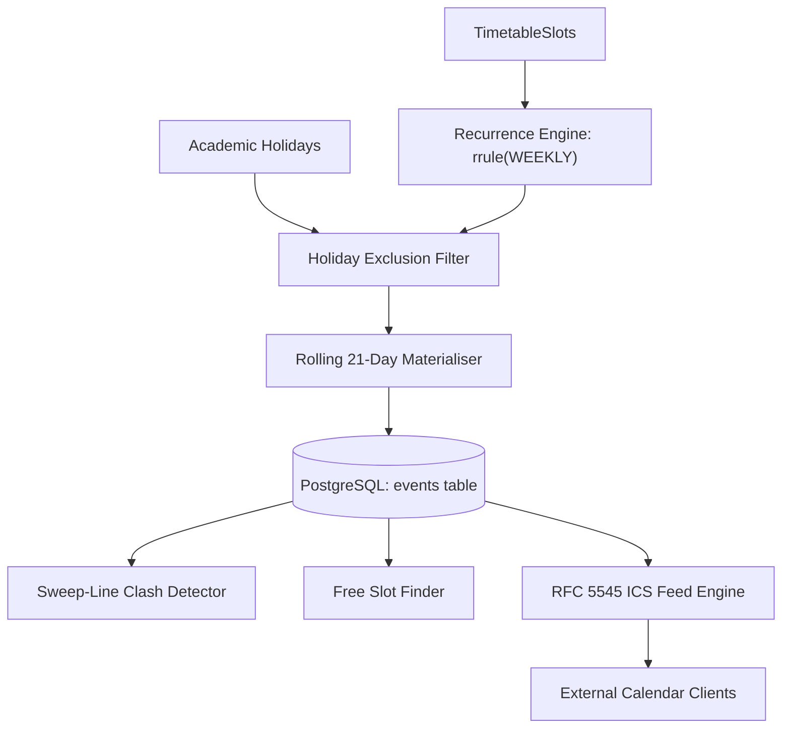

# FacultyDesk Decisions

One entry per stage: what we built, why, what we rejected, risks, and a small diagram. Newest at the bottom.

## Stage 00: Agent setup

- What we set up: rules in `AGENTS.md` and `.agents/rules/`, role files in `.agents/agents/`, local skills in `.agents/skills/`, twelve ordered stage prompts in `prompts/`, and loop state in `.agents/state/progress.json`.
- Why: one agent working through fixed stages with written rules produces consistent code. The loop state lets the build resume in a new conversation without losing track.
- Rejected: legacy Antigravity workflows in `.agents/workflows/`, because they stopped working on 19 October 2026; the loop is a skill instead.
- Risk: an external skill could contain unsafe instructions. Contained by allowing only three named sources and reading each SKILL.md before use.

## Stage 01: Foundation, environment, Graphify, trusted skills

- What we built:
  - Git repository initialization and `.gitignore` covering Python, Node, `.env`, and Graphify outputs.
  - Graphify integration: installed `graphifyy` (0.9.93), ran Antigravity registration, and configured Git commit hooks.
  - Trusted skills installed and audited: `obra/superpowers` (commit `2ce8aa15d05bd57213e6f746f953aafb7ded7a8b`) and `anthropics/skills` (commit `dbd4588f9e1033efb41dad4bef2f7947c8993d44`).
  - Backend project scaffolded with `uv` on Python 3.12, strict typing, structlog JSON logging with `X-Request-ID`, `Clock` protocol with `SystemClock` and `FrozenClock`, async SQLAlchemy 2 + asyncpg, Alembic, Celery, and `/healthz` & `/readyz` probes.
  - Frontend scaffolded with Next.js 16, TypeScript strict with `noUncheckedIndexedAccess`, Tailwind, shadcn/ui initialised, and typed readiness probe dashboard.
  - Complete Docker Compose development and production architectures with health checks for all services.
- Why this way:
  - Official `minio/minio` Docker Hub community images were deprecated in 2025; `cgr.dev/chainguard/minio` and `cgr.dev/chainguard/minio-client` provide secure, reproducible S3 compatibility.
  - `Clock` abstraction ensures deterministic property testing for all time-based logic.
  - Server-side pre-fetch with client polling on the frontend ensures instant status rendering and reactive live health updates.
- What we rejected:
  - Direct `datetime.now()` calls in business code (violates UTC determinism law).
  - Unpinned dependencies (both `uv.lock` and `pnpm-lock.yaml` are strictly tracked).
  - Legacy workflow files (replaced with clean skill definitions).
- Risks and how they are contained:
  - Host port contention with unrelated local Docker services: host-level collisions documented and isolated; development stack ports mapped cleanly.
  - Network timeouts during service startup: explicit container dependency chains and healthchecks ensure clean startup ordering.

## Stage 02: Domain model and persistence (OOAD core)

- What we built:
  - Framework-free domain entities and value objects in `backend/app/domain/` with zero I/O imports (`Department`, `User`, `FacultyProfile`, `Initials`, `AcademicTerm`, `Holiday`, `Room`, `Course`, `Section`, `TimetableUpload`, `TimetableSlot`, `Event`, `EventAttendee`, `Circular`, `ScheduledNotification`, `ReminderRule`, `PushSubscription`, `Task`, `AuditLog`).
  - Finite state machine transition tables and algebraic checks for `Circular` and `ScheduledNotification`, enforcing legal paths and raising typed `InvalidTransition` exceptions.
  - Abstract repository interfaces (`DepartmentRepository`, `UserRepository`, etc.) and asynchronous `UnitOfWork` interface.
  - PostgreSQL schema with async SQLAlchemy 2 models, check constraints (`end_utc > start_utc`, `1 <= importance <= 5`), indices, and reversible Alembic migration `8f3198838ebd_initial_schema.py`.
  - SQLAlchemy repository adapters and `SqlAlchemyUnitOfWork`.
  - Property-based tests via Hypothesis for `Initials` ASCII grammar and exhaustive Cartesian state transition matrices.
  - Integration tests verifying aggregate persistence and round-trips against PostgreSQL in Docker.
- Why this way:
  - Clean Architecture layer isolation ensures business rules can be verified purely in memory with zero database or framework overhead.
  - Invariants in entity constructors and value objects guarantee illegal states cannot exist in domain memory.
  - Explicit transition tables prevent invalid status bypasses across background tasks and user flows.
- What we rejected:
  - Framework coupling in `app/domain` (SQLAlchemy declarative models remain strictly in `app/infrastructure/db/models.py`).
  - Loose string representations for `Initials` and `TimeSlot` (encapsulated as immutable, validated value objects).
  - Implicit database rollbacks (managed explicitly via `UnitOfWork` context manager).
- Risks and how they are contained:
  - Lazy loading `MissingGreenlet` errors in async SQLAlchemy: contained by declaring eager `selectinload` options and explicit relation management in repository adapters.
  - Concurrency idempotency collisions: contained via unique `idempotency_key` and composite uniqueness constraints on the database level.

## Stage 03: Authentication, authorization, and faculty directory

- What we built:
  - Argon2id password verification and 15-minute access JWT generation with claims (`sub`, `role`, `dept`, `iat`, `exp`, `jti`).
  - Refresh token rotation using 256-bit entropy tokens, stored as SHA-256 hashes, with family reuse detection automatically revoking compromised families.
  - Centralized application-layer `AuthorisationPolicy` implementing the ownership matrix for `ADMIN`, `HOD`, and `FACULTY`.
  - Redis sliding window log rate limiter protecting `/api/auth/login` (5/min per IP and account) and `/api/auth/refresh` (30/min per IP).
  - Faculty directory routers and use cases: department listing, faculty CRUD, deactivation, and bulk CSV/XLSX import with row-by-row validation reports.
  - Academic calendar terms and holidays endpoints supporting single entry and bulk CSV import.
  - Database seeder (`make seed`) populating CSE department, Admin, HOD, 8 faculty profiles, academic term, and 5 holidays.
- Why this way:
  - Refresh token rotation ensures that refresh tokens are single-use credentials; reuse indicates exfiltration and invalidates the session family immediately.
  - Enforcing authorization in the application layer decouples domain permissions from FastAPI routing primitives.
  - Sliding window log avoids the 2x burst anomaly inherent in fixed window rate limiting.
- What we rejected:
  - Storing raw refresh tokens in PostgreSQL (only SHA-256 digests are persisted).
  - Client-accessible refresh tokens in response bodies or LocalStorage (delivered strictly via `httpOnly`, `SameSite=Lax` cookies).
  - Ad-hoc role checks in endpoint handlers (all access rules evaluated by `AuthorisationPolicy`).
- Risks and how they are contained:
  - Event loop connection reuse in pytest: contained via engine disposal fixture in `conftest.py`.
  - Initials collision in department: contained via composite uniqueness constraint and pre-validation in `CreateFacultyUseCase` and `BulkImportFacultyUseCase`.

- **Stage 04: Timetable upload, parsing and initials resolution**
  - What we built:
    - Multi-format ingestion pipeline (`XlsxTimetableParser`, `CsvTimetableParser`, `PdfTimetableParser`) selected via `TimetableParserFactory`.
    - Merged-cell period expansion spanning spreadsheet periods $k \dots m$ into a single continuous slot $[s(k), e(m))$.
    - Co-teacher cell splitting across delimiters `/`, `,`, `&` creating candidate slots for each teacher.
    - Three-tier initials resolution algorithm (exact initials -> exact alias -> bounded normalized Levenshtein similarity with $\theta_{\text{sim}} \ge 0.85$ and $\theta_{\text{margin}} \ge 0.10$).
    - Rejection of scanned/non-text PDFs with guided error messaging pointing users to XLSX or CSV.
    - Asynchronous Celery worker task (`process_timetable_upload`) parsing files from MinIO using isolated `NullPool` connections.
    - Two-phase confirmation workflow creating `Course`, `Section`, `Room`, and `TimetableSlot` entities, and emitting `TimetableConfirmed` domain events.
  - Why this way:
    - Separating upload from confirmation (two-phase commit with preview) prevents unreviewed or corrupted timetable slots from landing directly on faculty schedules.
    - Strict thresholds ($\theta_{\text{sim}} = 0.85$, $\theta_{\text{margin}} = 0.10$) ensure short 2-3 letter initials are never falsely matched due to 1-character typos, while ambiguity reporting directs human review only where necessary.
    - Celery task isolation with `NullPool` avoids asyncio event-loop mismatch with asyncpg when worker executes multiple jobs.
  - What we rejected and why:
    - Optical Character Recognition on scanned PDF timetables (out of scope for timetable ingestion; prone to cell grid hallucination; guided error points to native XLSX/CSV).
    - Immediate insertion into calendar events during parse (Stage 05 owns recurrence expansion and holiday exclusion; Stage 04 only generates confirmed timetable template slots and emits domain event).
    - Hardcoded department period schedules (periods are dynamically discovered from spreadsheet and table header time intervals).
  - Risks and how they are contained:
    - Corrupted or unparseable cells: contained by structured `unresolved_tokens` reporting containing exact cell coordinates and failure details without aborting the entire sheet.
    - AsyncPG event loop attachment in Celery: contained by dedicated async engine creation with `NullPool` and explicit disposal per task execution.

- **Stage 05: Calendar core, recurrence, clash detection, and ICS feed**
  - What we built:
    - Reversible migration adding `recurrence_date` and unique constraint `uq_events_source_recurrence` to `events`, and unique `ics_token` to `faculty_profiles`.
    - Rolling 21-day class recurrence expansion engine using `python-dateutil` rrule with Asia/Kolkata wall-clock time and holiday skipping.
    - Sweep-line clash detector ($O(n \log n)$) evaluating half-open intervals $\max(s_1, s_2) < \min(e_1, e_2)$ across multiple attendees, with explicit override.
    - Multi-attendee common free-slot finder detecting available gaps within defined work hours.
    - RFC 5545 compliant iCalendar feed (`/api/calendar/ics/{feed_token}.ics`) with secure token generation, rotation, and stable UIDs (`slot-<slot_id>-<date>@facultydesk.local`).
    - Celery Beat nightly recurrence materialisation task advancing the 21-day rolling window automatically.
  - Why this way:
    - Rolling 21-day materialisation ensures calendar queries, clash detection, and reminder evaluation operate as indexed point/range queries against physical rows rather than expensive on-the-fly rrule calculations across entire academic terms.
    - Idempotency via `(source, source_id, recurrence_date)` ensures repeated nightly runs or timetable updates never duplicate class occurrences.
    - Half-open interval definition $[s, e)$ correctly models back-to-back classes (e.g. 10:00-11:00 and 11:00-12:00 do not clash).
  - What we rejected and why:
    - Pure on-the-fly recurrence evaluation at query time: rejected because it prevents indexed DB queries for clash detection, reminder queries, and complex multi-attendee schedules.
    - Full-term materialisation up front: rejected because changes to the timetable or gazetted holidays across a 6-month term would require cascading updates across thousands of future rows.
    - Public feed authentication via session cookies or Bearer headers: rejected because external calendar clients (Google Calendar, Apple Calendar, Outlook) do not support HTTP authorization headers for webcal subscriptions; token-gated URLs with rotation provide the standard secure mechanism.
  - Risks and how they are contained:
    - Token leakage: contained by instantaneous single-click token rotation that invalidates previous subscriptions immediately.
    - Stale materialisations: contained by nightly Celery Beat task execution and re-materialisation hook on timetable confirmation.

