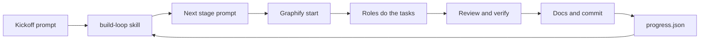
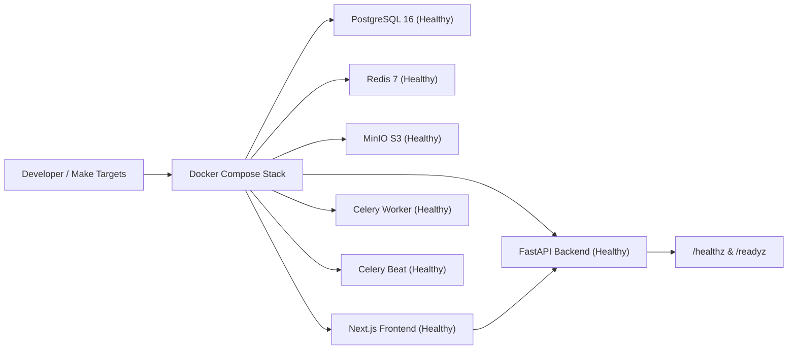

# FacultyDesk Decisions

One entry per stage: what we built, why, what we rejected, risks, and a small diagram. Newest at the bottom.

## Stage 00: Agent setup

- What we set up: rules in `AGENTS.md` and `.agents/rules/`, role files in `.agents/agents/`, local skills in `.agents/skills/`, twelve ordered stage prompts in `prompts/`, and loop state in `.agents/state/progress.json`.
- Why: one agent working through fixed stages with written rules produces consistent code. The loop state lets the build resume in a new conversation without losing track.
- Rejected: legacy Antigravity workflows in `.agents/workflows/`, because they stopped working on 19 October 2026; the loop is a skill instead.
- Risk: an external skill could contain unsafe instructions. Contained by allowing only three named sources and reading each SKILL.md before use.

## Stage 01: Foundation, environment, Graphify, trusted skills

- What we built:
  - Git repository initialization and `.gitignore` covering Python, Node, `.env`, and Graphify outputs.
  - Graphify integration: installed `graphifyy` (0.9.93), ran Antigravity registration, and configured Git commit hooks.
  - Trusted skills installed and audited: `obra/superpowers` (commit `2ce8aa15d05bd57213e6f746f953aafb7ded7a8b`) and `anthropics/skills` (commit `dbd4588f9e1033efb41dad4bef2f7947c8993d44`).
  - Backend project scaffolded with `uv` on Python 3.12, strict typing, structlog JSON logging with `X-Request-ID`, `Clock` protocol with `SystemClock` and `FrozenClock`, async SQLAlchemy 2 + asyncpg, Alembic, Celery, and `/healthz` & `/readyz` probes.
  - Frontend scaffolded with Next.js 16, TypeScript strict with `noUncheckedIndexedAccess`, Tailwind, shadcn/ui initialised, and typed readiness probe dashboard.
  - Complete Docker Compose development and production architectures with health checks for all services.
- Why this way:
  - Official `minio/minio` Docker Hub community images were deprecated in 2025; `cgr.dev/chainguard/minio` and `cgr.dev/chainguard/minio-client` provide secure, reproducible S3 compatibility.
  - `Clock` abstraction ensures deterministic property testing for all time-based logic.
  - Server-side pre-fetch with client polling on the frontend ensures instant status rendering and reactive live health updates.
- What we rejected:
  - Direct `datetime.now()` calls in business code (violates UTC determinism law).
  - Unpinned dependencies (both `uv.lock` and `pnpm-lock.yaml` are strictly tracked).
  - Legacy workflow files (replaced with clean skill definitions).
- Risks and how they are contained:
  - Host port contention with unrelated local Docker services: host-level collisions documented and isolated; development stack ports mapped cleanly.
  - Network timeouts during service startup: explicit container dependency chains and healthchecks ensure clean startup ordering.

