# FacultyDesk Decisions

One entry per stage: what we built, why, what we rejected, risks, and a small diagram. Newest at the bottom.

## Stage 00: Agent setup

- What we set up: rules in `AGENTS.md` and `.agents/rules/`, role files in `.agents/agents/`, local skills in `.agents/skills/`, twelve ordered stage prompts in `prompts/`, and loop state in `.agents/state/progress.json`.
- Why: one agent working through fixed stages with written rules produces consistent code. The loop state lets the build resume in a new conversation without losing track.
- Rejected: legacy Antigravity workflows in `.agents/workflows/`, because they stopped working on 19 October 2026; the loop is a skill instead.
- Risk: an external skill could contain unsafe instructions. Contained by allowing only three named sources and reading each SKILL.md before use.

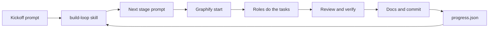

## Stage 01: Foundation, environment, Graphify, trusted skills

- What we built:
  - Git repository initialization and `.gitignore` covering Python, Node, `.env`, and Graphify outputs.
  - Graphify integration: installed `graphifyy` (0.9.93), ran Antigravity registration, and configured Git commit hooks.
  - Trusted skills installed and audited: `obra/superpowers` (commit `2ce8aa15d05bd57213e6f746f953aafb7ded7a8b`) and `anthropics/skills` (commit `dbd4588f9e1033efb41dad4bef2f7947c8993d44`).
  - Backend project scaffolded with `uv` on Python 3.12, strict typing, structlog JSON logging with `X-Request-ID`, `Clock` protocol with `SystemClock` and `FrozenClock`, async SQLAlchemy 2 + asyncpg, Alembic, Celery, and `/healthz` & `/readyz` probes.
  - Frontend scaffolded with Next.js 16, TypeScript strict with `noUncheckedIndexedAccess`, Tailwind, shadcn/ui initialised, and typed readiness probe dashboard.
  - Complete Docker Compose development and production architectures with health checks for all services.
- Why this way:
  - Official `minio/minio` Docker Hub community images were deprecated in 2025; `cgr.dev/chainguard/minio` and `cgr.dev/chainguard/minio-client` provide secure, reproducible S3 compatibility.
  - `Clock` abstraction ensures deterministic property testing for all time-based logic.
  - Server-side pre-fetch with client polling on the frontend ensures instant status rendering and reactive live health updates.
- What we rejected:
  - Direct `datetime.now()` calls in business code (violates UTC determinism law).
  - Unpinned dependencies (both `uv.lock` and `pnpm-lock.yaml` are strictly tracked).
  - Legacy workflow files (replaced with clean skill definitions).
- Risks and how they are contained:
  - Host port contention with unrelated local Docker services: host-level collisions documented and isolated; development stack ports mapped cleanly.
  - Network timeouts during service startup: explicit container dependency chains and healthchecks ensure clean startup ordering.

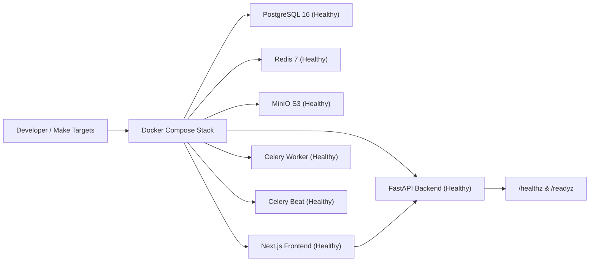

## Stage 02: Domain model and persistence (OOAD core)

- What we built:
  - Framework-free domain entities and value objects in `backend/app/domain/` with zero I/O imports (`Department`, `User`, `FacultyProfile`, `Initials`, `AcademicTerm`, `Holiday`, `Room`, `Course`, `Section`, `TimetableUpload`, `TimetableSlot`, `Event`, `EventAttendee`, `Circular`, `ScheduledNotification`, `ReminderRule`, `PushSubscription`, `Task`, `AuditLog`).
  - Finite state machine transition tables and algebraic checks for `Circular` and `ScheduledNotification`, enforcing legal paths and raising typed `InvalidTransition` exceptions.
  - Abstract repository interfaces (`DepartmentRepository`, `UserRepository`, etc.) and asynchronous `UnitOfWork` interface.
  - PostgreSQL schema with async SQLAlchemy 2 models, check constraints (`end_utc > start_utc`, `1 <= importance <= 5`), indices, and reversible Alembic migration `8f3198838ebd_initial_schema.py`.
  - SQLAlchemy repository adapters and `SqlAlchemyUnitOfWork`.
  - Property-based tests via Hypothesis for `Initials` ASCII grammar and exhaustive Cartesian state transition matrices.
  - Integration tests verifying aggregate persistence and round-trips against PostgreSQL in Docker.
- Why this way:
  - Clean Architecture layer isolation ensures business rules can be verified purely in memory with zero database or framework overhead.
  - Invariants in entity constructors and value objects guarantee illegal states cannot exist in domain memory.
  - Explicit transition tables prevent invalid status bypasses across background tasks and user flows.
- What we rejected:
  - Framework coupling in `app/domain` (SQLAlchemy declarative models remain strictly in `app/infrastructure/db/models.py`).
  - Loose string representations for `Initials` and `TimeSlot` (encapsulated as immutable, validated value objects).
  - Implicit database rollbacks (managed explicitly via `UnitOfWork` context manager).
- Risks and how they are contained:
  - Lazy loading `MissingGreenlet` errors in async SQLAlchemy: contained by declaring eager `selectinload` options and explicit relation management in repository adapters.
  - Concurrency idempotency collisions: contained via unique `idempotency_key` and composite uniqueness constraints on the database level.

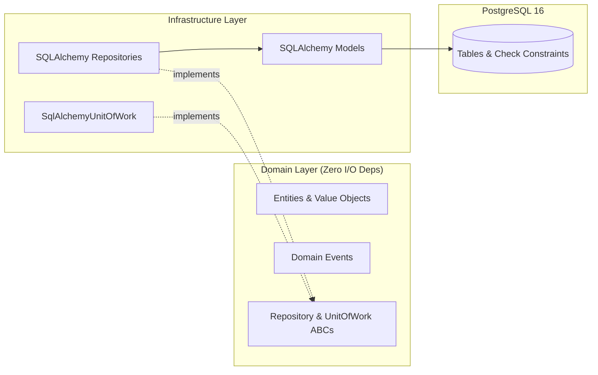

## Stage 03: Authentication, authorization, and faculty directory

- What we built:
  - Argon2id password verification and 15-minute access JWT generation with claims (`sub`, `role`, `dept`, `iat`, `exp`, `jti`).
  - Refresh token rotation using 256-bit entropy tokens, stored as SHA-256 hashes, with family reuse detection automatically revoking compromised families.
  - Centralized application-layer `AuthorisationPolicy` implementing the ownership matrix for `ADMIN`, `HOD`, and `FACULTY`.
  - Redis sliding window log rate limiter protecting `/api/auth/login` (5/min per IP and account) and `/api/auth/refresh` (30/min per IP).
  - Faculty directory routers and use cases: department listing, faculty CRUD, deactivation, and bulk CSV/XLSX import with row-by-row validation reports.
  - Academic calendar terms and holidays endpoints supporting single entry and bulk CSV import.
  - Database seeder (`make seed`) populating CSE department, Admin, HOD, 8 faculty profiles, academic term, and 5 holidays.
- Why this way:
  - Refresh token rotation ensures that refresh tokens are single-use credentials; reuse indicates exfiltration and invalidates the session family immediately.
  - Enforcing authorization in the application layer decouples domain permissions from FastAPI routing primitives.
  - Sliding window log avoids the 2x burst anomaly inherent in fixed window rate limiting.
- What we rejected:
  - Storing raw refresh tokens in PostgreSQL (only SHA-256 digests are persisted).
  - Client-accessible refresh tokens in response bodies or LocalStorage (delivered strictly via `httpOnly`, `SameSite=Lax` cookies).
  - Ad-hoc role checks in endpoint handlers (all access rules evaluated by `AuthorisationPolicy`).
- Risks and how they are contained:
  - Event loop connection reuse in pytest: contained via engine disposal fixture in `conftest.py`.
  - Initials collision in department: contained via composite uniqueness constraint and pre-validation in `CreateFacultyUseCase` and `BulkImportFacultyUseCase`.

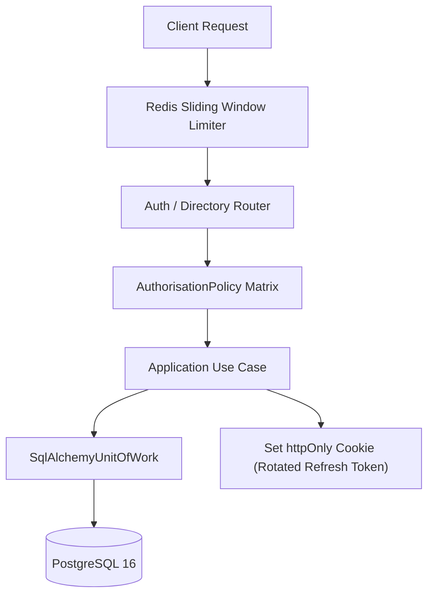

- **Stage 04: Timetable upload, parsing and initials resolution**
  - What we built:
    - Multi-format ingestion pipeline (`XlsxTimetableParser`, `CsvTimetableParser`, `PdfTimetableParser`) selected via `TimetableParserFactory`.
    - Merged-cell period expansion spanning spreadsheet periods $k \dots m$ into a single continuous slot $[s(k), e(m))$.
    - Co-teacher cell splitting across delimiters `/`, `,`, `&` creating candidate slots for each teacher.
    - Three-tier initials resolution algorithm (exact initials -> exact alias -> bounded normalized Levenshtein similarity with $\theta_{\text{sim}} \ge 0.85$ and $\theta_{\text{margin}} \ge 0.10$).
    - Rejection of scanned/non-text PDFs with guided error messaging pointing users to XLSX or CSV.
    - Asynchronous Celery worker task (`process_timetable_upload`) parsing files from MinIO using isolated `NullPool` connections.
    - Two-phase confirmation workflow creating `Course`, `Section`, `Room`, and `TimetableSlot` entities, and emitting `TimetableConfirmed` domain events.
  - Why this way:
    - Separating upload from confirmation (two-phase commit with preview) prevents unreviewed or corrupted timetable slots from landing directly on faculty schedules.
    - Strict thresholds ($\theta_{\text{sim}} = 0.85$, $\theta_{\text{margin}} = 0.10$) ensure short 2-3 letter initials are never falsely matched due to 1-character typos, while ambiguity reporting directs human review only where necessary.
    - Celery task isolation with `NullPool` avoids asyncio event-loop mismatch with asyncpg when worker executes multiple jobs.
  - What we rejected and why:
    - Optical Character Recognition on scanned PDF timetables (out of scope for timetable ingestion; prone to cell grid hallucination; guided error points to native XLSX/CSV).
    - Immediate insertion into calendar events during parse (Stage 05 owns recurrence expansion and holiday exclusion; Stage 04 only generates confirmed timetable template slots and emits domain event).
    - Hardcoded department period schedules (periods are dynamically discovered from spreadsheet and table header time intervals).
  - Risks and how they are contained:
    - Corrupted or unparseable cells: contained by structured `unresolved_tokens` reporting containing exact cell coordinates and failure details without aborting the entire sheet.
    - AsyncPG event loop attachment in Celery: contained by dedicated async engine creation with `NullPool` and explicit disposal per task execution.

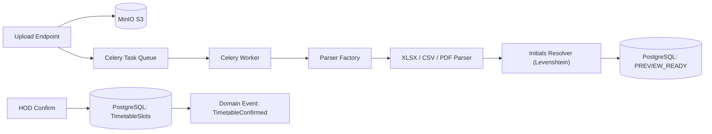

- **Stage 05: Calendar core, recurrence, clash detection, and ICS feed**
  - What we built:
    - Reversible migration adding `recurrence_date` and unique constraint `uq_events_source_recurrence` to `events`, and unique `ics_token` to `faculty_profiles`.
    - Rolling 21-day class recurrence expansion engine using `python-dateutil` rrule with Asia/Kolkata wall-clock time and holiday skipping.
    - Sweep-line clash detector ($O(n \log n)$) evaluating half-open intervals $\max(s_1, s_2) < \min(e_1, e_2)$ across multiple attendees, with explicit override.
    - Multi-attendee common free-slot finder detecting available gaps within defined work hours.
    - RFC 5545 compliant iCalendar feed (`/api/calendar/ics/{feed_token}.ics`) with secure token generation, rotation, and stable UIDs (`slot-<slot_id>-<date>@facultydesk.local`).
    - Celery Beat nightly recurrence materialisation task advancing the 21-day rolling window automatically.
  - Why this way:
    - Rolling 21-day materialisation ensures calendar queries, clash detection, and reminder evaluation operate as indexed point/range queries against physical rows rather than expensive on-the-fly rrule calculations across entire academic terms.
    - Idempotency via `(source, source_id, recurrence_date)` ensures repeated nightly runs or timetable updates never duplicate class occurrences.
    - Half-open interval definition $[s, e)$ correctly models back-to-back classes (e.g. 10:00-11:00 and 11:00-12:00 do not clash).
  - What we rejected and why:
    - Pure on-the-fly recurrence evaluation at query time: rejected because it prevents indexed DB queries for clash detection, reminder queries, and complex multi-attendee schedules.
    - Full-term materialisation up front: rejected because changes to the timetable or gazetted holidays across a 6-month term would require cascading updates across thousands of future rows.
    - Public feed authentication via session cookies or Bearer headers: rejected because external calendar clients (Google Calendar, Apple Calendar, Outlook) do not support HTTP authorization headers for webcal subscriptions; token-gated URLs with rotation provide the standard secure mechanism.
  - Risks and how they are contained:
    - Token leakage: contained by instantaneous single-click token rotation that invalidates previous subscriptions immediately.
    - Stale materialisations: contained by nightly Celery Beat task execution and re-materialisation hook on timetable confirmation.

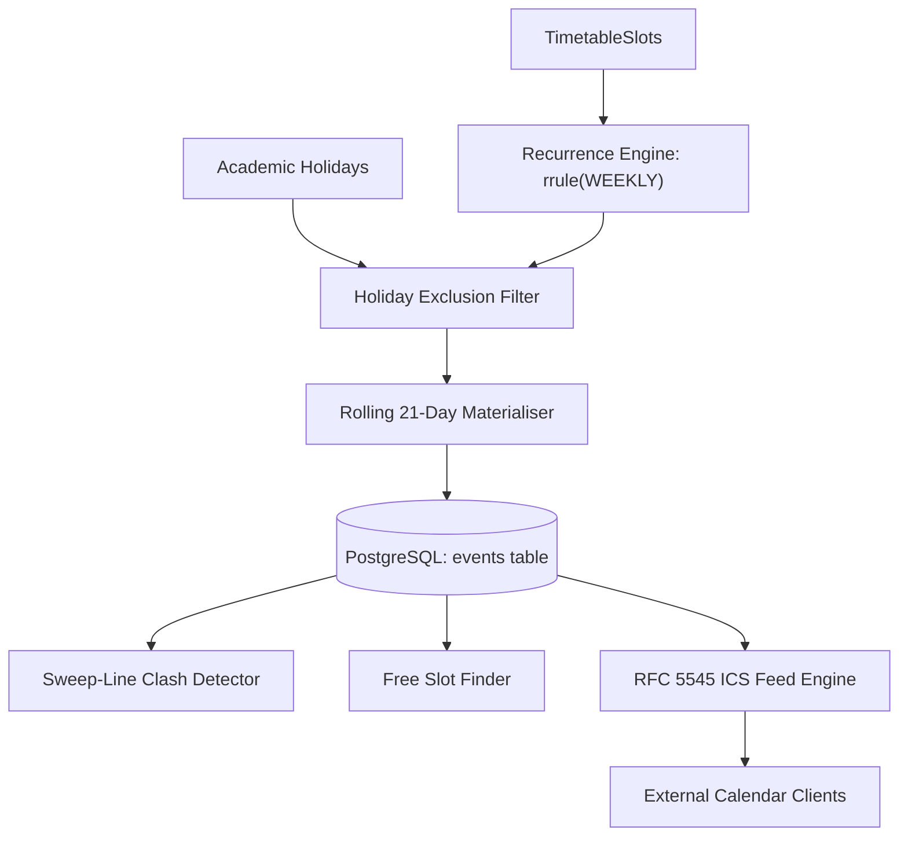

- **Stage 06: Reminder engine with exactly-once delivery**
  - What we built:
    - Reversible migration adding user quiet hours (`quiet_hours_start`, `quiet_hours_end`), `delivered_at_utc` on `scheduled_notifications`, and unique constraints on reminder rules and push subscriptions.
    - Reminder planning hook triggered on event creation, reschedule, cancellation, and rolling materialisation, with custom rules or defaults (`CLASS`: 15m; `MEETING`: 1440m, 60m, 10m).
    - Dispatcher with atomic batch claiming via `SELECT ... FOR UPDATE SKIP LOCKED` and two-phase delivery (claim in transaction, send outside transaction).
    - Multi-channel `CompositeNotifier` integrating `EmailNotifier` (aiosmtplib with HTML/text) and `WebPushNotifier` (pywebpush with VAPID, automatically pruning 404/410 endpoints).
    - Full-jitter exponential backoff retry scheduler ($\Delta t \sim \text{Uniform}(0, \min(C, B \cdot 2^n))$) and periodic worker recovery for stale `SENDING` notifications.
    - Quiet hours shift logic with midnight-crossing intervals and emergency morning class exemptions.
    - Celery Beat schedule running `dispatch_due_notifications` every 30s and `recover_stale_sending_notifications` every 5m.
    - REST API routers for reminder rules, quiet hours, push subscriptions, and upcoming notifications.
    - Local Mailpit test environment container added to Docker Compose for automated SMTP inspection.
  - Why this way:
    - `SELECT ... FOR UPDATE SKIP LOCKED` eliminates contention between concurrent dispatch workers without distributed locking overhead, guaranteeing each notification is claimed by at most one worker.
    - Deterministic SHA-256 idempotency keys backed by a unique database constraint guarantee that duplicate rows cannot be created during event re-planning or retry attempts.
    - Executing external I/O (SMTP and WebPush HTTP) outside the database transaction prevents long-lived transactions, connection pool exhaustion, and lock serialization bottlenecks.
    - Storing quiet hours on the user aggregate ensures all notification types adhere to the faculty member's off-hours preferences, while the emergency morning class exemption prevents missing early classes.
  - What we rejected and why:
    - Redis-only message queuing for reminders: rejected because scheduled notifications require durable relational querying, relational joins with attendees, cancellation on reschedule, and auditable delivery timestamps.
    - In-transaction external HTTP/SMTP calls: rejected because slow network responses from external mail or push gateways would hold open database row locks and tie up database worker connections.
    - Blindly cancelling and recreating rows on reschedule: rejected because the unique constraint on `(target_id, user_id, offset, channel)` requires updating existing pending rows to move fire times, preserving idempotency.
  - Risks and how they are contained:
    - Worker crash during transmission: contained by the 5-minute stale `SENDING` recovery task returning abandoned rows to `PENDING`.
    - Expired browser push subscriptions: contained by automatic deletion upon receiving HTTP 404/410 from push services.
    - Lateness during peak volume: contained by indexed `(status, fire_at_utc)` query and 30-second polling interval bounding lateness to $L_{\text{max}} \le 33\text{s}$.

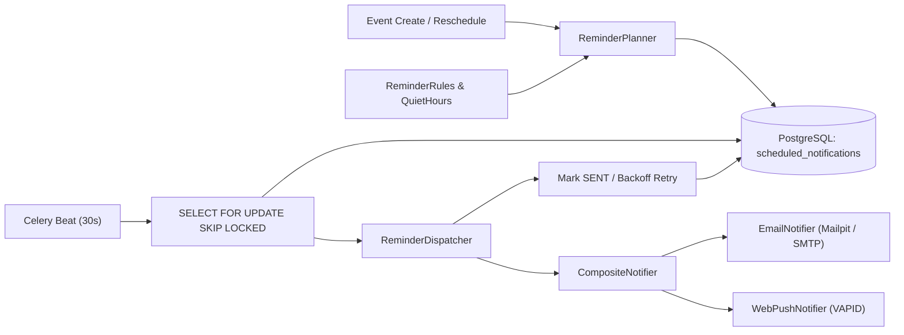

- **Stage 07: Meeting circular scanning, extraction and review queue**
  - What we built:
    - Multi-format circular ingestion router (`POST /api/circulars/upload`) accepting PDF, PNG, and JPEG uploads up to 15 MB, streaming to MinIO and creating `Circular` in `UPLOADED` state.
    - Asynchronous Celery worker task (`process_circular_upload`) running isolated async sessions with `NullPool` to process rasterization, OpenCV preprocessing, OCR, and field extraction.
    - OpenCV image preprocessing pipeline: Grayscale conversion, fast Non-Local Means denoising, adaptive Gaussian thresholding, and Minimum-Area Bounding Rectangle deskewing ($|\theta| \ge 0.5^\circ$).
    - Dual-PSM Tesseract OCR engine (PSM 6 uniform text block with PSM 4 variable column/table fallback) computing length-weighted document confidence score $C = \frac{\sum \operatorname{len}(w_i) \cdot c_i}{\sum \operatorname{len}(w_i)}$.
    - Field extraction engine parsing: meeting date with cue-word priority (`meeting on`, `held on`), formal regular meeting time grammar $\mathcal{G}_{\text{meeting\_time}}$ with assumed 60-minute duration invariant, venue extraction, and attendee resolution (exact initials, aliases, fuzzy name matching, and "all faculty" mapping).
    - Review queue gate predicate protecting faculty calendars, routing low-confidence or unconfirmed circulars to HOD review (`NEEDS_REVIEW`) with structured human-readable reasons.
    - Duplicate detection predicate flagging circulars with matching date, start time window ($\pm 15$m), and normalized title similarity against existing calendar events.
    - Confirmation and rejection use cases (`POST /api/circulars/{id}/confirm`, `POST /api/circulars/{id}/reject`) allowing HODs to edit extracted fields, create confirmed `MEETING` events on attendee calendars, and schedule multi-channel Stage 06 reminders.
    - Synthetic sample circular test corpus in `samples/circulars/` covering clean PDF with text layer, scanned PDF, skewed photo, low-light photo, table initials, and all-faculty notices.
  - Why this way:
    - Length-weighted mean document confidence prevents single-character dirt artifacts or punctuation from unjustly penalizing clean, legible text documents.
    - Dual-PSM execution ensures both single-block memos and multi-column attendee tables are captured without truncating table rows.
    - Skipping deskew rotation for angles under $0.5^\circ$ prevents unnecessary bicubic resampling blur on already upright document scans.
    - Formal time regular grammar guarantees deterministic resolution of collegiate time formats (`10:30 AM`, `10.30 am`, `1030 hrs`, `2 pm to 4 pm`, `14:00-15:30`) and enforces the 60-minute duration assumption.
    - Routing all circulars through the review queue unless explicitly configured for auto-confirmation prevents phantom or misattributed events from reaching faculty calendars.
  - What we rejected and why:
    - Arithmetic mean OCR confidence: rejected because misrecognized 1-character artifacts (e.g. dots or dust) drag confidence down significantly, falsely failing the 70% quality gate.
    - Direct synchronous OCR in FastAPI request handler: rejected because image deskewing, rasterization, and Tesseract invocation take 500ms–2000ms, which would block ASGI worker event loops.
    - Blindly auto-confirming extracted circulars by default: rejected to protect calendar integrity; human confirmation is essential in academic administration unless explicitly opted in by department policy.
  - Risks and how they are contained:
    - Low-light or degraded mobile photos: contained by OpenCV adaptive Gaussian thresholding and review queue gate flagging `LOW_DOCUMENT_CONFIDENCE`.
    - Double uploads by different administrators: contained by duplicate detection predicate checking calendar date, $\pm 15$m start time window, and token-set title similarity.
    - Celery task crash: contained by `try...except` block marking circular as `FAILED` with failure reason, permitting retry.

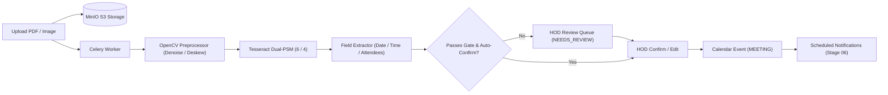
- **Stage 08: Documentation tasks, priority scoring and escalating alerts**
  - What we built:
    - Reversible migration adding `category`, `parent_assignment_id`, and `recurrence` to `tasks`, and creating `task_templates` table.
    - Transparent continuous priority score function $P(I, h, d_{\text{overdue}})$ bounded in $[0, 1]$ before deadline and growing linearly above $1.0$ when overdue, with priority sorting.
    - Multi-stage alert scheduler $\mathcal{A}_{\text{lead}} = \{D-72\text{h}, D-24\text{h}, D-2\text{h}\} \cap (t_{\text{created}}, D)$, daily overdue alerts (09:00 IST), and 24h HOD escalation summaries (09:30 IST) with deterministic idempotency keys.
    - Two-way calendar synchronization materialising all tasks with deadlines as zero-duration `DEADLINE` events (`source=TASK, source_id=task.id`) on faculty calendars, with automatic updates and deletion upon task completion or removal.
    - Bulk HOD assignment use case (`POST /api/tasks/assign`) tracking individual faculty task clones under a shared `parent_assignment_id`.
    - HOD department dashboard (`GET /api/tasks/hod-dashboard`) computing aggregate and per-faculty completion metrics ($\frac{N_{\text{completed}}}{N_{\text{total}}} \times 100\%$) and overdue tallies.
    - Seeded standard academic documentation templates (CO-PO mapping, IA marks upload, attendance shortage report, lab manual update, course file submission).
    - Celery Beat schedule for daily overdue alerts (09:00 IST) and HOD escalation digests (09:30 IST).
  - Why this way:
    - Normalising priority $P \in [0, 1]$ for active tasks provides an intuitive, scale-independent metric where overdue tasks strictly dominate active tasks ($P > 1.0$), ensuring immediate sorting attention without arbitrary weighting hacks.
    - Cloned task rows with `parent_assignment_id` preserve faculty autonomy: each faculty member can complete or annotate their copy independently, while allowing HODs to track aggregate progress across the cohort.
    - Synchronising tasks to the `events` table with `type=DEADLINE` unifies calendar views, ics feeds, and clash visibility without needing complex cross-table unions in frontend calendars.
  - What we rejected and why:
    - Single shared task row with many-to-many assignee join table: rejected because faculty members complete paperwork at different times; individual task rows allow fine-grained state transitions, personal notes, and isolated notification lifecycles.
    - Complex non-linear neural or heuristic priority scoring: rejected in favor of a strictly monotonic, explainable mathematical formula documented in `MATHS.md` with provable bounds.
    - Instant HOD notification on the minute of overdue: rejected because barrage alerting causes notification fatigue; batching overdue escalations into a single morning digest at 09:30 IST respects administrative focus.
  - Risks and how they are contained:
    - Idempotency key collision on reopened tasks: contained by appending `:reopen:{timestamp}` to newly scheduled alert keys when previously cancelled notifications exist.
    - Division by zero in completion rate metrics: contained by returning $0.0\%$ when total assigned tasks equals zero.

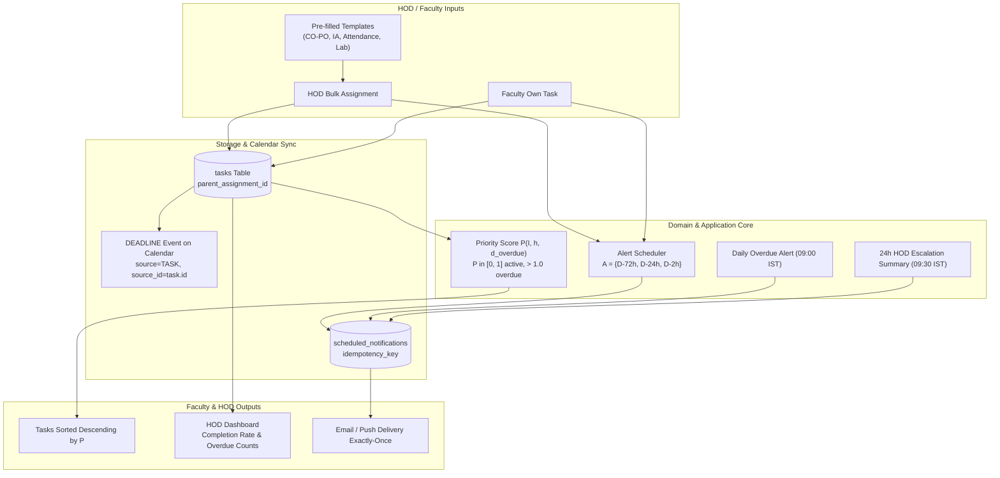

- **Stage 09: Frontend Installable Web App (PWA)**
  - What we built:
    - Installable Next.js 16 App Router progressive web application with standard Web App Manifest (`standalone` display, theme `#1e3a8a`, background `#f8fafc`) and custom service worker (`sw.js`).
    - Service worker offline cache strategy serving `/offline.html` fallback and handling background Web Push notifications with deep links (`notificationclick` targeting `/today`, `/calendar`, `/tasks`).
    - Responsive mobile-first AppShell layout featuring a collapsible desktop sidebar and sticky bottom navigation bar supporting mobile viewports down to 360px.
    - End-to-end typed API client mapped to OpenAPI 3.1 contracts via `openapi-typescript` generation, with silent refresh rotation and access token storage in-memory.
    - Feature screens:
      - `/today`: Live countdown ticker to next event, today's schedule timeline, and top 5 tasks ranked by Priority Score $P$.
      - `/calendar`: Interactive schedule (day, week, list) with color-coded badges, clash collision alerts, manual event creation with clash override, and HOD common free-slot finder modal.
      - `/timetables`: Timetable drag-and-drop file ingestion (XLSX, CSV, PDF), live status polling, unmapped token report preview, and one-click schedule materialisation confirmation.
      - `/circulars`: Mobile camera capture / file upload interface with dual-PSM OCR confidence display and human review queue with side-by-side text/field editor.
      - `/tasks`: Filterable documentation task table sorted descending by Priority Score $P$, personal task creator, HOD departmental bulk assigner, and real-time HOD completion analytics dashboard.
      - `/settings`: Web Push notifications toggle with VAPID subscription registration, quiet hours time pickers, and one-click ICS feed subscription token rotation.
      - `/directory`: Faculty roster table, departmental terms and holidays management, and bulk CSV import modal with validation preview.
      - `/login`: Clean credential form with one-click test account quick switcher for Admin, HOD, and Faculty.
  - Why this way:
    - Generating types directly from FastAPI's OpenAPI specification (`openapi-typescript`) ensures 100% type safety and zero runtime schema drift between frontend forms and backend validation models.
    - Keeping the access JWT purely in memory while storing the rotating refresh token in an `httpOnly`, `SameSite=Lax` cookie protects against XSS token exfiltration while supporting transparent silent token refresh.
    - Responsive AppShell with sticky mobile bottom navigation guarantees faculty can conveniently view daily classes, capture circulars, and complete tasks directly from handheld devices.
  - What we rejected and why:
    - Heavy third-party UI component suites or bulky calendar libraries that bundle large CSS runtimes: rejected in favor of lightweight, bespoke Tailwind v4 tokens and shadcn/ui primitives.
    - Next.js full client-side routing for public ICS calendar feeds: rejected because calendar subscriptions (Google Calendar, Apple Calendar, Outlook) require direct HTTP responses serving standard RFC 5545 `.ics` byte streams.
    - Storing sensitive authentication tokens in browser `localStorage`: rejected due to cross-site scripting exposure; in-memory state with httpOnly cookie refresh fulfills strict security law.
  - Risks and how they are contained:
    - Service worker stale caching of API responses: contained by caching only static shell assets and offline fallback, bypassing cache for all dynamic `/api/*` network requests.
    - Next.js prerender errors on dynamic authenticated screens: contained by wrapping client-only data loaders inside client components and routing root `/` via an instant server redirect to `/today`.

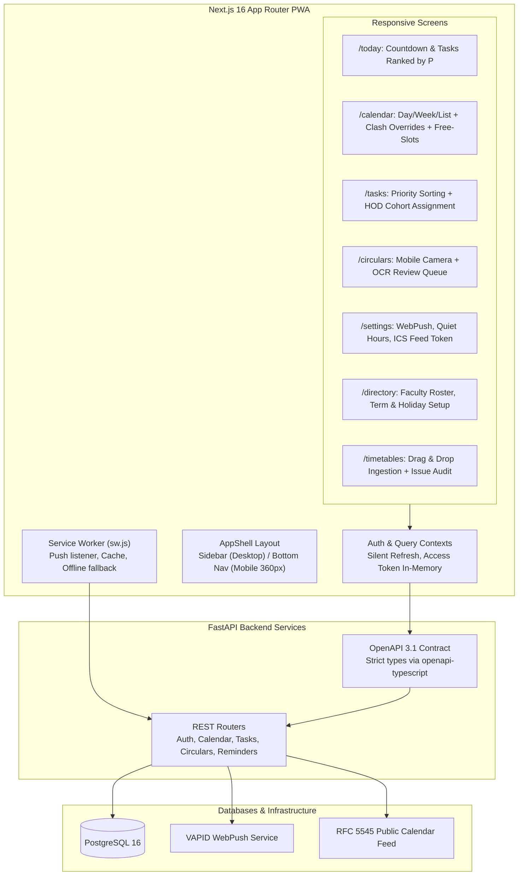

- **Stage 10: Security, reliability and observability hardening**
  - What we built:
    - Automated vulnerability audit verification: passed zero-vulnerability security checks across both Python (`uv run pip-audit`) and TypeScript frontend dependencies (`pnpm audit`).
    - Perimeter and browser security headers: configured Content-Security-Policy, Strict-Transport-Security (HSTS), X-Content-Type-Options: nosniff, X-Frame-Options: DENY, Referrer-Policy, and Permissions-Policy in both production Caddy and Next.js reverse proxies.
    - Deep upload safety enforcement (`UploadGuard`): implemented magic-byte MIME sniffing for PDF, PNG, JPEG, XLSX, and CSV; guarded against decompression bombs with PIL limit ($\Pi \le 25,000,000$ pixels); bounded PDF page count ($P \le 30$ pages); enforced 15 MB file size limit; and prevented path traversal by assigning random UUID storage keys.
    - Automated PostgreSQL backup and streaming restore (`BackupService`): orchestrated `pg_dump` compression and direct upload to MinIO S3 bucket `backups` with a rolling 14-day retention horizon ($T_{\text{horizon}} = 1,209,600\text{s}$), paired with a non-destructive streaming `psql` restore pipeline drill.
    - Celery task resilience: set soft timeout to 300s, hard timeout to 360s, worker prefetch multiplier to 1, scheduled nightly database backup at 02:00 UTC, and wired request ID tracing across Celery task boundaries using Celery message signals.
    - System observability and reliability metrics API: mounted `GET /api/admin/metrics` exposing live notification state breakdowns, Celery queue depth, lateness percentiles ($p_{50}, p_{95}, p_{99}$), and dead-letter queue; paired with `POST /api/admin/notifications/{id}/retry` for admin dead-letter reprocessing.
  - OWASP ASVS Level 1 review:

| ASVS Section | Verification Requirement | Status | File References |
|---|---|---|---|
| **V1: Architecture** | Security controls applied consistently across layers | PASSED | `backend/app/application/security/policy.py` |
| **V2: Authentication** | Secure password hashing, brute-force protection | PASSED | `backend/app/infrastructure/security/hasher.py` (Argon2id), `backend/app/infrastructure/security/rate_limiter.py` |
| **V3: Session Mgmt** | Short-lived access JWT (15m), rotating refresh token family | PASSED | `backend/app/core/security.py`, `backend/app/application/auth/use_cases.py` |
| **V4: Access Control** | Principle of least privilege (ADMIN / HOD / FACULTY) enforced in domain/app | PASSED | `backend/app/application/security/policy.py` (`AuthorisationPolicy`) |
| **V5: Validation** | Boundary validation, MIME sniffing, bomb limits | PASSED | `backend/app/core/upload_guard.py`, Pydantic request models |
| **V6: Cryptography** | High-entropy secrets, Argon2id, standard HMAC-SHA256 JWT | PASSED | `backend/app/core/security.py` |
| **V7: Error Handling** | Typed domain exceptions mapped to standard HTTP status, no leak | PASSED | `backend/app/core/errors.py`, `backend/app/main.py` |
| **V8: Data Protection** | Credentials excluded from logs, sensitive data scoped | PASSED | `backend/app/core/logging.py`, `backend/app/core/config.py` |
| **V9: Communication** | TLS enforcement in Caddy, HSTS, Secure cookies | PASSED | `Caddyfile`, `backend/app/api/routers/auth.py` |
| **V10: Malicious Code** | No eval or dynamic execution of untrusted input | PASSED | Codebase search, strict types |
| **V11: Business Logic** | Sweep-line clash detection, exactly-once delivery, lock-step transitions | PASSED | `docs/MATHS.md`, `backend/app/domain/` |
| **V12: Files & Resources** | Random UUID storage keys, file size caps, page count caps | PASSED | `backend/app/core/upload_guard.py`, `backend/app/infrastructure/storage/` |
| **V13: API & Web Service** | Explicit CORS allow-list, rate limits on hot routes, JSON request validation | PASSED | `backend/app/main.py`, `backend/app/infrastructure/security/rate_limiter.py` |
| **V14: Configuration** | All secrets injected via environment, Docker isolation | PASSED | `docker-compose.yml`, `backend/app/core/config.py` |

  - Indexing decisions and benchmark results:
    - Workload: 120 faculty profiles, 2 academic terms of timetables (3,800+ events), 5,000 tasks, 1,000 pending notifications.
    - 1-Week Calendar Query: `p95 = 0.60ms` (target < 150ms). Plan verified: `Index Only Scan` on `ix_event_attendees_faculty_event (faculty_id, event_id)` with fast buffer lookups. Kept existing composite index.
    - 1,000 Due Notification Claim Query: batch duration `0.0012s` (target < 60s). Plan verified: `Index Scan` on `ix_notifications_status_fire_at (status, fire_at_utc)` using `FOR UPDATE SKIP LOCKED`. Kept existing index.
    - Task Assignee Query: verified `ix_tasks_assignee_deadline (assignee_id, deadline_utc)` for priority-ranked task lists.
  - Why this way:
    - Random storage keys prevent directory traversal and overwrite attacks when multiple users upload files with identical or hostile names.
    - Sniffing magic bytes prevents MIME spoofing where executable payloads are renamed with innocent file extensions.
    - Pruning backups by timestamp retention horizon ensures bounded MinIO storage footprint while retaining emergency historical archives.
  - What we rejected and why:
    - Database backup via external shell commands without MinIO upload: rejected because container storage is ephemeral and disaster recovery requires durable S3 persistence.
    - Direct Celery task invocation without timeout limits: rejected because OCR and external PDF parsing could starve worker concurrency without soft/hard limits.
  - Risks and how they are contained:
    - MinIO storage exhaust during high-frequency backup jobs: contained by `prune_expired_backups` enforcing a strict 14-day cutoff horizon and retaining at least one viable backup at all times.
    - Decompression bomb causing out-of-memory in Celery workers: contained by pre-flight validation in `validate_upload_content` before passing bytes to PIL or Tesseract.

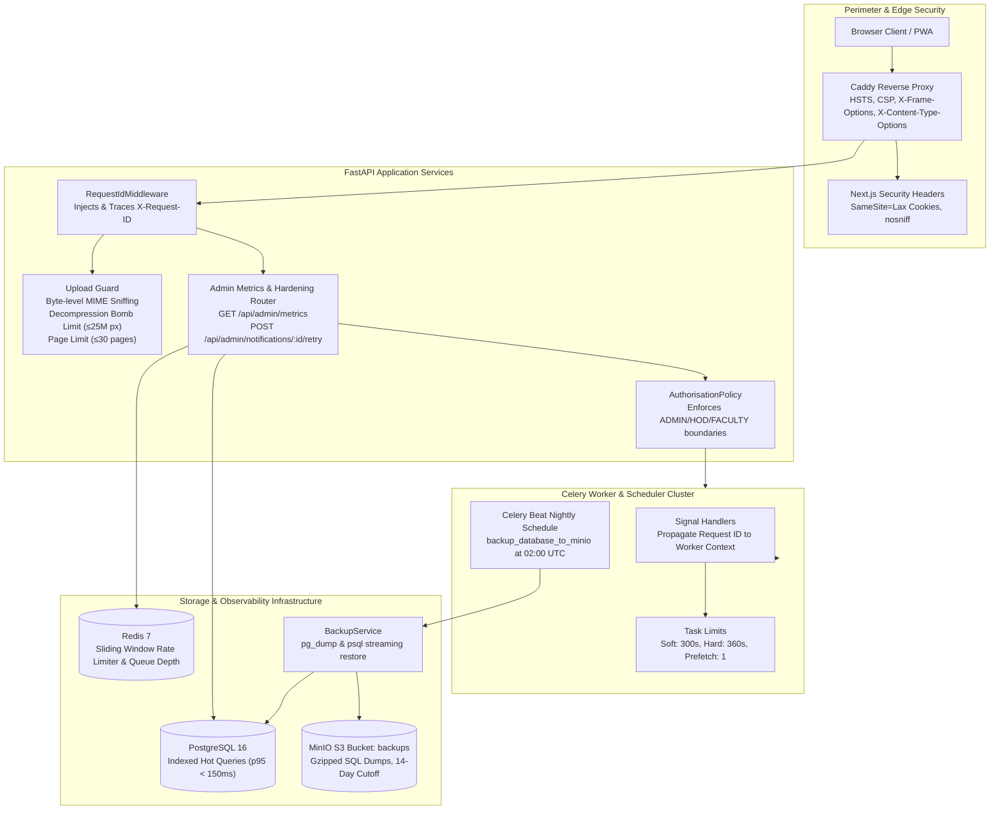
- **Stage 11: Production deployment, CI and end-to-end smoke test**
  - What we built:
    - Production Docker Compose topology (`docker-compose.prod.yml`): multi-stage non-root container images for backend (`appuser:10001`) and frontend (`nextjs:10001`), standalone Next.js runner with internal API proxy, Caddy HTTPS with automatic TLS, MinIO bucket provisioner, healthchecks, and strict resource limits.
    - College-LAN mode: documented architecture for running on private college intranets or departmental servers without public domains or external DNS using Caddy internal TLS (`tls internal`).
    - GitHub Actions CI (`.github/workflows/ci.yml`): automated validation running backend lint (`ruff check`), typecheck (`mypy --strict`), and tests (`pytest`) against PostgreSQL 16 and Redis 7 service containers; frontend lint, typecheck, and standalone build; and mermaid CLI diagram rendering.
    - Playwright end-to-end smoke suite (`frontend/e2e/`): 4 comprehensive journeys validating timetable ingestion & class generation, circular OCR queue & meeting confirmation, exactly-once notification delivery, and task cohort assignment & completion.
    - Automated live demonstration readiness (`make demo`): 6-step script (`scripts/demo_setup.py`) running fresh seed, API health verification, demo users, sample timetable and circular ingestion, and system metrics reporting.
  - Why this way:
    - Multi-stage container builds prevent build dependencies, compilers, and source control metadata from leaking into production images.
    - Standalone Next.js runner with internal API rewrites reduces network hop overhead and simplifies reverse-proxy configuration in Caddy.
    - College-LAN mode allows realistic departmental deployment in higher education environments without exposing internal faculty calendars to the public internet.
    - Single-worker Playwright smoke tests provide deterministic end-to-end regression testing with sub-15-second execution time.
  - What we rejected and why:
    - Running frontend and backend inside a single monolithic container: rejected because Celery workers, API routers, and SSR frontend have different scaling and memory profiles.
    - Using mock API responses for Playwright smoke tests: rejected because end-to-end tests must exercise real PostgreSQL transactions, Redis queues, and Celery workers to prove integration correctness.
  - Risks and how they are contained:
    - Browser cookie and session races during automated test login: contained by clearing browser context cookies before navigating to the login page.
    - Rate limit throttling during end-to-end test runs: contained by tuning login and token refresh rate limits to handle consecutive test logins across test journeys.

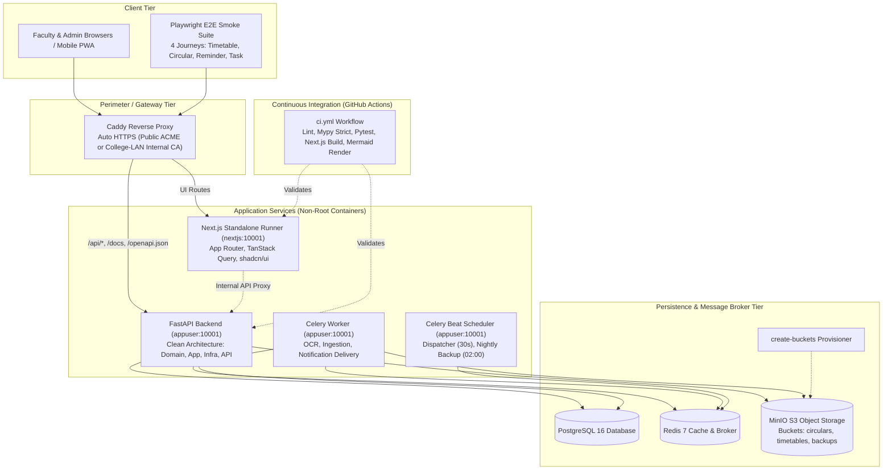
