# FacultyDesk

## 1. Problem and users

Faculty juggle classes from a timetable, meetings announced on paper circulars, and documentation deadlines. Today these live in different places and reminders depend on memory. FacultyDesk puts all of it on one calendar and reminds each person at the right time.

| Actor | Goal |
|---|---|
| Admin | Manage departments, faculty directory, terms and holidays |
| HOD | Upload timetables, review circulars, assign documentation tasks, see progress |
| Faculty | See classes and meetings, get reminders, track own tasks |
| Scheduler (system) | Plan and send reminders, refresh calendars nightly |

## 2. Features that exist now

- Monorepo foundation with backend (FastAPI, Python 3.12, SQLAlchemy 2 async, Alembic, Celery, Redis, MinIO) and frontend (Next.js 16 App Router, TypeScript strict, Tailwind, shadcn/ui).
- Injected `Clock` system (`SystemClock`, `FrozenClock`) with mathematical invariants proving canonical UTC handling.
- Structured JSON logging (`structlog`) with distributed request ID tracking (`X-Request-ID`).
- Health probes: `/healthz` (liveness) and `/readyz` (dependency readiness probing PostgreSQL `SELECT 1`, Redis `PING`, and MinIO bucket verification).
- Interactive Frontend dashboard displaying real-time system readiness probe status.
- Framework-free domain layer (`Department`, `User`, `FacultyProfile`, `Initials`, `AcademicTerm`, `Holiday`, `Room`, `Course`, `Section`, `TimetableUpload`, `TimetableSlot`, `Event`, `EventAttendee`, `Circular`, `ScheduledNotification`, `ReminderRule`, `PushSubscription`, `Task`, `AuditLog`, `RefreshToken`).
- Deterministic finite state machines for `Circular` (7 transitions) and `ScheduledNotification` (5 transitions) raising typed `InvalidTransition` on illegal transitions.
- Fully reversible Alembic migrations (`8f3198838ebd_initial_schema.py`, `8434d6a0dd0a_add_refresh_tokens.py`) supporting database schema creation, token rotation, and rollback.
- Async SQLAlchemy repository implementations and `SqlAlchemyUnitOfWork`.
- Authentication system with Argon2id password hashing, 15-minute HS256 access JWTs, and rotating 7-day refresh tokens delivered via httpOnly cookies.
- Refresh token family reuse detection automatically revoking all tokens in a compromised family upon re-presentation.
- Centralized `AuthorisationPolicy` evaluating ownership predicates across `ADMIN`, `HOD`, and `FACULTY` roles.
- Redis-backed Sliding Window Log rate limiter protecting `/api/auth/login` (5/min per IP and account) and `/api/auth/refresh` (30/min per IP).
- Faculty directory management with department CRUD, individual faculty creation/updates, deactivation, and bulk CSV/XLSX import with validation reports.
- Academic calendar terms and holidays management supporting single entry and bulk CSV imports.
- Synthetic database seeder (`make seed`) populating CSE department, Admin, HOD, faculty profiles, academic term, and holidays.
- Multi-format Timetable Ingestion engine supporting XLSX (with merged-cell period expansion), long-format CSV, and text-layer PDF with table extraction.
- Deterministic 3-tier initials resolution (exact initials -> exact alias -> bounded normalized Levenshtein similarity with theta_sim >= 0.85 and theta_margin >= 0.10) preventing false matches.
- Celery worker asynchronous parsing pipeline generating preview slots and detailed unmapped token issue reports.
- Two-phase upload & confirm workflow creating `Course`, `Section`, `Room`, and `TimetableSlot` entities, and emitting `TimetableConfirmed` domain events.
- Rolling 21-day class recurrence materialisation pipeline expanding weekly timetable slots, respecting term boundaries, and skipping academic holidays.
- Sweep-line clash detection algorithm ($O(n \log n)$) evaluating half-open intervals $\max(s_1, s_2) < \min(e_1, e_2)$ across multiple attendees, with explicit override capability returning 409 Conflict with clash details.
- Multi-attendee common free-slot finder detecting non-overlapping working intervals for meeting scheduling.
- RFC 5545 compliant iCalendar (`.ics`) subscription feed with token gating, automatic token rotation, and stable UIDs (`slot-<slot_id>-<date>@facultydesk.local`).
- Celery Beat nightly rolling materialisation task automatically advancing the 21-day window at midnight.
- Multi-channel notification engine (HTML/text Email via aiosmtplib and WebPush via pywebpush with VAPID) delivering reminders for classes and meetings.
- Exactly-once reminder delivery guarantees with deterministic SHA-256 idempotency keys, atomic `SELECT FOR UPDATE SKIP LOCKED` batch claiming, and full-jitter exponential backoff retry scheduling.
- Stale `SENDING` notification worker recovery protecting against worker crashes.
- Configurable reminder rules per event kind (`CLASS`, `MEETING`, `DEADLINE`) with offsets and channel preferences.
- User-specific quiet hours window ($Q = [q_s, q_e)$) supporting midnight-crossing windows and emergency morning class start exemptions.
- Meeting circular upload pipeline supporting PDFs, PNG, and JPEG up to 15 MB with byte-level MIME validation.
- OCR preprocessing engine: Grayscale conversion, Non-Local Means denoising, Adaptive Gaussian thresholding, and Minimum-Area Bounding Rectangle deskewing ($|\theta| \ge 0.5^\circ$).
- Dual-PSM Tesseract OCR engine (PSM 6 uniform text block with PSM 4 variable column/table layout fallback) computing length-weighted document confidence $C = \frac{\sum \operatorname{len}(w_i) \cdot c_i}{\sum \operatorname{len}(w_i)}$.
- Field extraction engine: Date parsing with cue-word priority (`meeting on`, `held on`), regular meeting time grammar $\mathcal{G}_{\text{meeting\_time}}$ (handling 5 time formats with assumed 60-minute duration invariant), venue extraction, and attendee resolution (exact initials, aliases, fuzzy full name, and "all faculty" mapping).
- Review queue gate predicate protecting faculty calendars, routing low-confidence or unconfirmed circulars to HOD review with human-readable reasons.
- Duplicate detection predicate checking calendar day, start time window ($\pm 15$m), and normalized title similarity against existing events.
- Circular confirmation workflow creating `MEETING` events on all attendees' calendars and scheduling multi-channel Stage 06 reminders.
- Task management and assignment system: Personal documentation task creation, HOD bulk assignment to individual faculty, multiple faculty, or department-wide with unique `parent_assignment_id`.
- Transparent Task Priority Scoring engine ($P \in [0, 1]$ for active tasks, $P \in (1, 2]$ for overdue tasks, $-1.0$ for completed tasks) balancing importance ($w_I = 0.4$) and exponential decay urgency ($w_U = 0.6, \tau = 48\text{h}$).
- Standard departmental task templates seeded via `make seed` (CO-PO mapping, IA marks upload, attendance shortage report, lab manual update, course file submission) with pre-filled category, importance, and lead days.
- Multi-tier alert schedule set ($\{D-72\text{h}, D-24\text{h}, D-2\text{h}\}$, daily overdue reminders at 09:00 IST, and 24h HOD escalation summaries at 09:30 IST) with strict exactly-once delivery.
- Automatic calendar synchronization establishing `DEADLINE` events (`EventKind.DEADLINE`) for every task, linked to task lifecycle.
- Full task lifecycle management: Completion automatically cancels all pending alerts, while reopening reactivates alerts for future deadlines.
- HOD dashboard analytics calculating assignment completion rates ($\frac{N_{\text{completed}}}{N_{\text{total}}} \times 100\%$) and per-faculty overdue counts.
- Installable Progressive Web App (PWA) with standard manifest (`standalone` display, theme `#1e3a8a`, background `#f8fafc`) and custom service worker (`sw.js`) with offline caching, push notifications, and deep links.
- Responsive mobile-first AppShell layout featuring a collapsible desktop sidebar and sticky bottom navigation bar supporting mobile viewports down to 360px.
- End-to-end typed API client mapped to OpenAPI 3.1 contracts via `openapi-typescript` generation, with silent refresh rotation and access token storage in-memory.
- Full suite of frontend screens: `/today` (countdown & timeline), `/calendar` (day/week/list + clash overrides + free-slots modal), `/timetables` (drag & drop ingestion + issue audit), `/circulars` (camera capture + confidence review queue), `/tasks` (priority score ranking + HOD cohort assignment), `/settings` (WebPush, quiet hours, ICS feed token), `/directory` (roster, term & holiday setup), and `/login` (quick switcher for Admin, HOD, and Faculty).
- Comprehensive perimeter security headers: Content-Security-Policy, Strict-Transport-Security (HSTS), X-Content-Type-Options: nosniff, X-Frame-Options: DENY, Referrer-Policy, and Permissions-Policy configured across Caddy and Next.js.
- File upload safety guard: Byte-level magic header MIME sniffing (PDF, PNG, JPEG, XLSX, CSV), decompression bomb defense limiting image dimensions to $\Pi \le 25,000,000$ pixels, PDF page bound ($P \le 30$ pages), 15 MB file size limit, and randomized UUID storage keys.
- Automated database backup and streaming restore (`BackupService`): Scheduled nightly PostgreSQL backups (`pg_dump` compressed with gzip) streamed to MinIO S3 bucket `backups` with a rolling 14-day retention horizon ($T_{\text{horizon}} = 1,209,600\text{s}$) and non-destructive streaming `psql` restore pipeline.
- Observability and reliability metrics API: `GET /api/admin/metrics` returning real-time notification status counts, Celery queue depth, lateness percentiles ($p_{50}, p_{95}, p_{99}$), and dead-letter queue; paired with `POST /api/admin/notifications/{id}/retry` for admin dead-letter reprocessing.
- Celery worker resilience: Distributed request ID context tracing, soft timeout (300s), hard timeout (360s), and worker prefetch multiplier 1.
- Database index optimization verified with EXPLAIN ANALYZE on a 120-faculty, 5,000-task, 2-term workload (1-week calendar query p95 = 0.60ms, 1,000 notification batch claim = 0.0012s).
- Docker Compose development and production environments with health checks on all services including Mailpit SMTP testing server.
- Knowledge graph indexing with Graphify and verified trusted skills suite.

## 3. Architecture

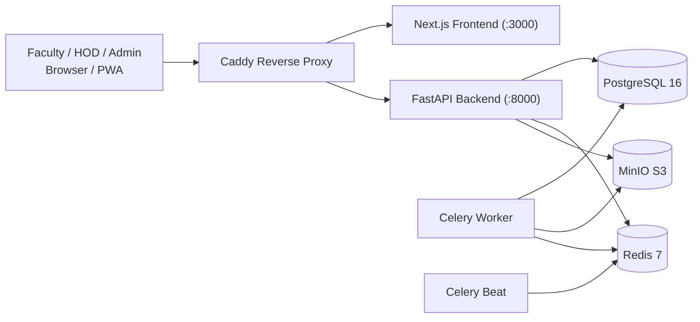

## 4. OOAD Design and Architecture

### 4.1 Evaluator Summary (10-Minute Read)

FacultyDesk is designed following strict Clean Architecture and Object-Oriented Analysis and Design (OOAD) principles. The software coordinates academic timetables, OCR-scanned paper circulars, personal calendars, and departmental task deadlines into a single automated, clash-aware schedule.

#### 4.1.1 Actors and System Goals
- **Admin**: System-wide configuration, department management, academic term boundaries, institution-wide holidays, and faculty directory administration.
- **HOD (Head of Department)**: Department timetable ingestion, unmapped initials review, paper circular confirmation, cohort task assignment, and compliance monitoring.
- **Faculty**: Personal schedule inspection across classes and meetings, schedule clash detection/override, token-gated RFC 5545 ICS feeds, personal and assigned task completion, and notification lead-time / quiet-hour preferences.
- **System Scheduler (Celery Beat & Workers)**: Periodic background tasks executing atomic `SKIP LOCKED` reminder dispatches (30s interval), nightly calendar recurrence materialisation (00:00 UTC), overdue task escalation summaries (09:30 IST), and automated database backups (02:00 UTC).

#### 4.1.2 Clean Architecture Layer Isolation
The backend codebase (`backend/app/`) enforces a unidirectional inward dependency rule across four isolated layers:
1. **Domain Layer (`domain/`)**: Pure business logic containing entities (`Event`, `Task`, `Circular`, `ScheduledNotification`), value objects (`Initials`, intervals), domain services (`SweepLineClashDetector`, `InitialsResolver`, `ReminderLeadTimeCalculator`, `TaskPriorityCalculator`), and repository interfaces (`EventRepository`, `TaskRepository`, etc.). **Law**: Zero dependencies on FastAPI, SQLAlchemy, Celery, Redis, or any I/O library.
2. **Application Layer (`application/`)**: Use cases orchestrating business flows (`CreateEventUseCase`, `ProcessCircularUseCase`, `AssignTaskUseCase`, `DispatchDueNotificationsUseCase`). Depends solely on domain abstractions and Unit of Work interfaces.
3. **Infrastructure Layer (`infrastructure/`)**: Concrete implementations of domain interfaces. Contains SQLAlchemy 2 async models, asyncpg repository adapters, Tesseract OCR wrappers, OpenCV image preprocessors, MinIO S3 object storage clients, and aiosmtplib / pywebpush notification senders.
4. **API Layer (`api/`)**: FastAPI routing, OpenAPI schema generation, HTTP header processing, authentication dependency wiring, and rate limiting.

#### 4.1.3 Core Domain Classes and Rationales
- **`Event` & `EventAttendee`**: Aggregate root representing any scheduled calendar interval $[s, e)$ in canonical UTC. Maintains recurrence invariants and attendee RSVP states.
- **`Circular`**: Aggregate managing the lifecycle of an uploaded meeting document, tracking dual-PSM OCR text, length-weighted confidence score, and extracted structured metadata.
- **`ScheduledNotification`**: Represents a scheduled communication channel delivery event. Governed by a state machine ensuring atomic dispatch, deterministic SHA-256 idempotency, and full-jitter exponential backoff retries.
- **`Task`**: Prioritised documentation task tracker with mathematical urgency-importance scoring ($P \in [0, 2]$), calendar synchronization (`DEADLINE` event), and multi-tier alert triggers.
- **`FacultyProfile` & `Initials`**: Encapsulates faculty identity, institutional initials (e.g. `KKS`), aliases, and token-gated ICS feed secrets.
- **`TimetableUpload` & `TimetableSlot`**: Aggregates for raw timetable files (XLSX, CSV, PDF), holding extracted grid cells, resolved faculty mappings, and unmapped tokens awaiting HOD review.
- **`RefreshToken`**: Security entity supporting rotating refresh token families with automated replay detection and revocation.

#### 4.1.4 Design Patterns in Codebase
| Design Pattern | Concrete Class(es) in Code | Purpose |
|---|---|---|
| **Repository** | `SqlAlchemyEventRepository`, `SqlAlchemyTaskRepository`, `SqlAlchemyCircularRepository`, `SqlAlchemyNotificationRepository` | Decouples domain logic from SQL schema and query construction |
| **Unit of Work** | `SqlAlchemyUnitOfWork` | Coordinates atomic transactional boundaries across multiple repositories |
| **Strategy** | `XlsxTimetableParser`, `CsvTimetableParser`, `PdfTimetableParser` | Encapsulates format-specific parsing algorithms behind `TimetableParser` interface |
| **Strategy (Notification)** | `EmailNotificationSender`, `WebPushNotificationSender`, `CompositeNotifier` | Decouples message delivery channel mechanics from dispatch orchestration |
| **Factory** | `TimetableParserFactory` | Dynamically instantiates the correct parser strategy based on sniffed magic bytes |
| **Observer (Domain Events)** | `TimetableConfirmed`, `CircularProcessed`, `TaskCompleted` | Decouples event generation from background materialisation and notification scheduling |
| **State** | `CircularStatus` (`Circular.start_processing()`, `mark_needs_review()`, `confirm()`, `fail()`), `NotificationStatus` (`ScheduledNotification.mark_sending()`, `mark_sent()`, `mark_failed()`) | Enforces legal lifecycle transitions via formal mathematical state algebras |

---

### 4.2 Requirements Traceability Matrix

Every functional requirement specified for FacultyDesk maps directly to use cases, domain classes, REST endpoints, UI screens, and verification tests:

| Requirement | Use Case Class | Domain Classes | REST Endpoints | Frontend Screen | Proof Test Name |
|---|---|---|---|---|---|
| **Timetable Upload & Ingestion** | `IngestTimetableUseCase`, `ConfirmTimetableUseCase` | `TimetableUpload`, `TimetableSlot`, `Course`, `Section`, `Room` | `POST /api/timetables/upload`, `GET /api/timetables/{id}`, `POST /api/timetables/{id}/confirm` | `/timetables` | `test_timetable_pipeline_e2e`, `test_parse_grid_xlsx_merged_cells`, `01-timetable-classes.spec.ts` |
| **Initials Detection & Matching** | `ResolveInitialsUseCase`, `InitialsResolver` | `Initials`, `FacultyProfile`, `InitialsResolution` | `GET /api/timetables/{id}` (audit report) | `/timetables` | `test_initials_matching_exact`, `test_initials_matching_fuzzy_levenshtein`, `test_co_teacher_initials_split` |
| **Meeting Circular OCR Scan** | `ProcessCircularUseCase`, `ReviewCircularUseCase` | `Circular`, `CircularStatus`, `FieldExtractor`, `DualPsmOcr` | `POST /api/circulars/upload`, `GET /api/circulars/review-queue`, `POST /api/circulars/{id}/confirm` | `/circulars` | `test_circular_pipeline_e2e`, `test_length_weighted_confidence`, `test_meeting_time_grammar_extraction`, `02-circular-meeting.spec.ts` |
| **Faculty Calendar & Clash Detection** | `CreateEventUseCase`, `GetFacultyCalendarUseCase`, `SweepLineClashDetector` | `Event`, `EventAttendee`, `EventKind`, `Clash` | `GET /api/calendar/events`, `POST /api/calendar/events`, `GET /api/calendar/free-slots`, `GET /api/calendar/ics/{token}.ics` | `/calendar`, `/today` | `test_sweep_line_clash_detection`, `test_free_slots_complement`, `test_ics_export_valid_rfc5545`, `01-timetable-classes.spec.ts` |
| **Meeting & Class Reminders** | `ScheduleRemindersUseCase`, `DispatchDueNotificationsUseCase` | `ScheduledNotification`, `NotificationStatus`, `ReminderRule` | `GET /api/reminders/upcoming`, `POST /api/reminders/rules`, `POST /api/settings/push-subscription` | `/settings`, `/today` | `test_reminder_dispatch_atomic_skip_locked`, `test_quiet_hours_shift_algebra`, `test_full_jitter_exponential_backoff`, `03-meeting-reminder-sent.spec.ts` |
| **To-Do List & Documentation Tasks** | `CreateTaskUseCase`, `AssignTaskUseCase`, `CompleteTaskUseCase` | `Task`, `TaskStatus`, `TaskPriorityCalculator` | `GET /api/tasks`, `POST /api/tasks`, `POST /api/tasks/assign`, `POST /api/tasks/{id}/complete` | `/tasks`, `/today` | `test_task_pipeline_e2e`, `test_task_priority_score_ordering`, `test_task_deadline_event_sync`, `04-task-completion-alerts.spec.ts` |
| **Documentation Work Escalation Alerts** | `ScheduleTaskAlertsUseCase`, `ScheduleHodEscalationAlertsUseCase` | `Task`, `ScheduledNotification`, `AuditLog` | `GET /api/tasks/cohorts/{parent_id}`, `GET /api/admin/metrics` | `/tasks` | `test_task_alert_schedule_d72_d24_d2`, `test_hod_overdue_escalation_summary`, `04-task-completion-alerts.spec.ts` |

---

### 4.3 Standard OOAD Diagram Pack

All eleven presentation diagrams below have been generated from real code and validated with `@mermaid-js/mermaid-cli`. High-resolution PNG and vector SVG versions are located in [`docs/diagrams/`](docs/diagrams/).

#### 4.3.1 Use Case Diagram
*Source: [`docs/diagrams/01-use-case.svg`](docs/diagrams/01-use-case.svg) | [`PNG`](docs/diagrams/01-use-case.png)*

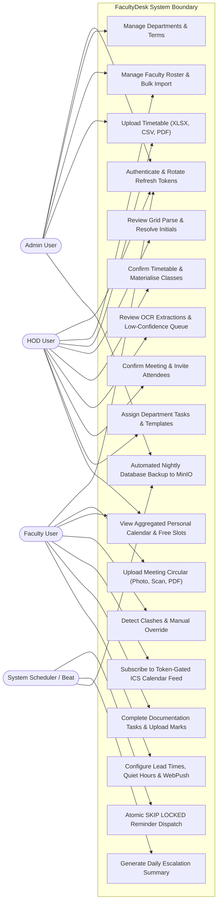

#### 4.3.2 Domain Class Diagram
*Source: [`docs/diagrams/02-class-domain.svg`](docs/diagrams/02-class-domain.svg) | [`PNG`](docs/diagrams/02-class-domain.png)*

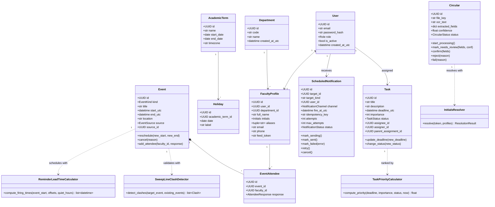

#### 4.3.3 Sequence Diagram: Timetable Upload and Class Materialisation
*Source: [`docs/diagrams/03-seq-timetable.svg`](docs/diagrams/03-seq-timetable.svg) | [`PNG`](docs/diagrams/03-seq-timetable.png)*

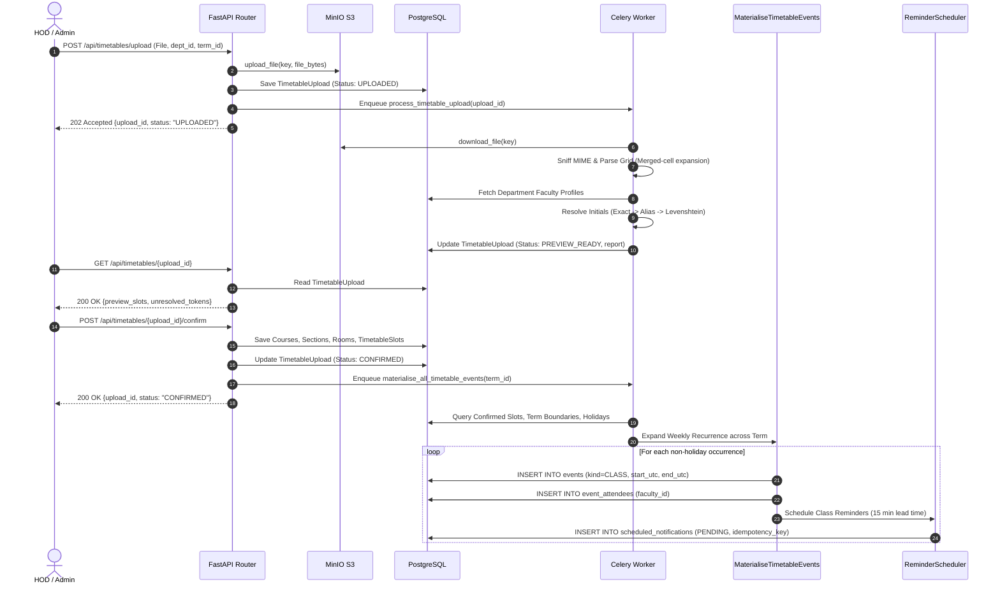

#### 4.3.4 Sequence Diagram: Circular OCR Scan & Review Queue
*Source: [`docs/diagrams/04-seq-circular.svg`](docs/diagrams/04-seq-circular.svg) | [`PNG`](docs/diagrams/04-seq-circular.png)*

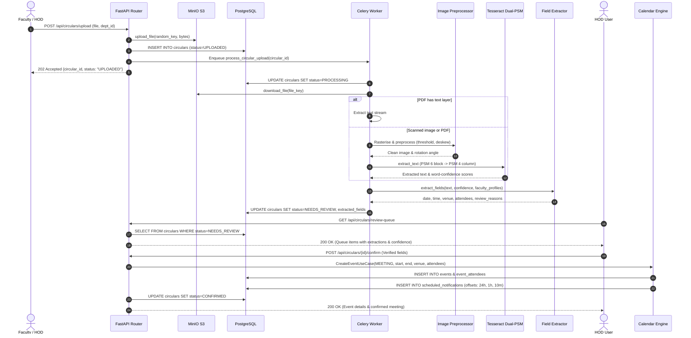

#### 4.3.5 Sequence Diagram: Periodic Reminder Dispatch (Atomic SKIP LOCKED)
*Source: [`docs/diagrams/05-seq-reminder.svg`](docs/diagrams/05-seq-reminder.svg) | [`PNG`](docs/diagrams/05-seq-reminder.png)*

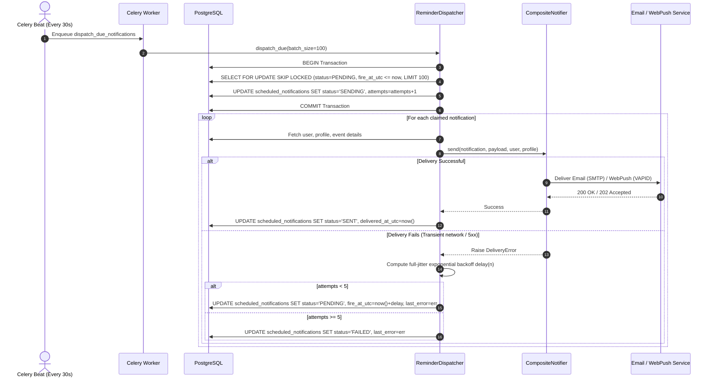

#### 4.3.6 State Diagram: Circular Lifecycle
*Source: [`docs/diagrams/06-state-circular.svg`](docs/diagrams/06-state-circular.svg) | [`PNG`](docs/diagrams/06-state-circular.png)*

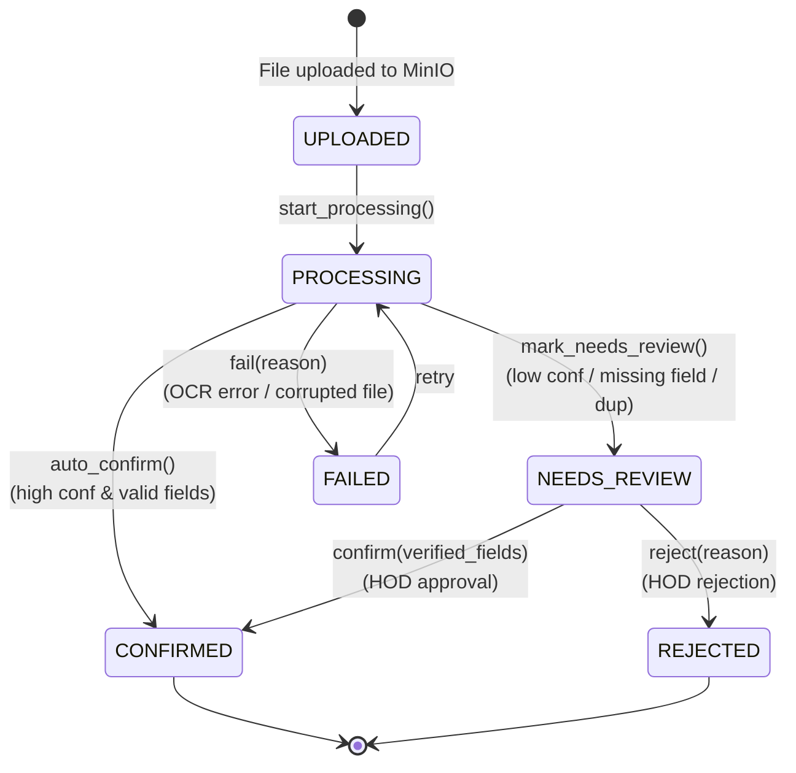

#### 4.3.7 State Diagram: ScheduledNotification Lifecycle
*Source: [`docs/diagrams/07-state-notification.svg`](docs/diagrams/07-state-notification.svg) | [`PNG`](docs/diagrams/07-state-notification.png)*

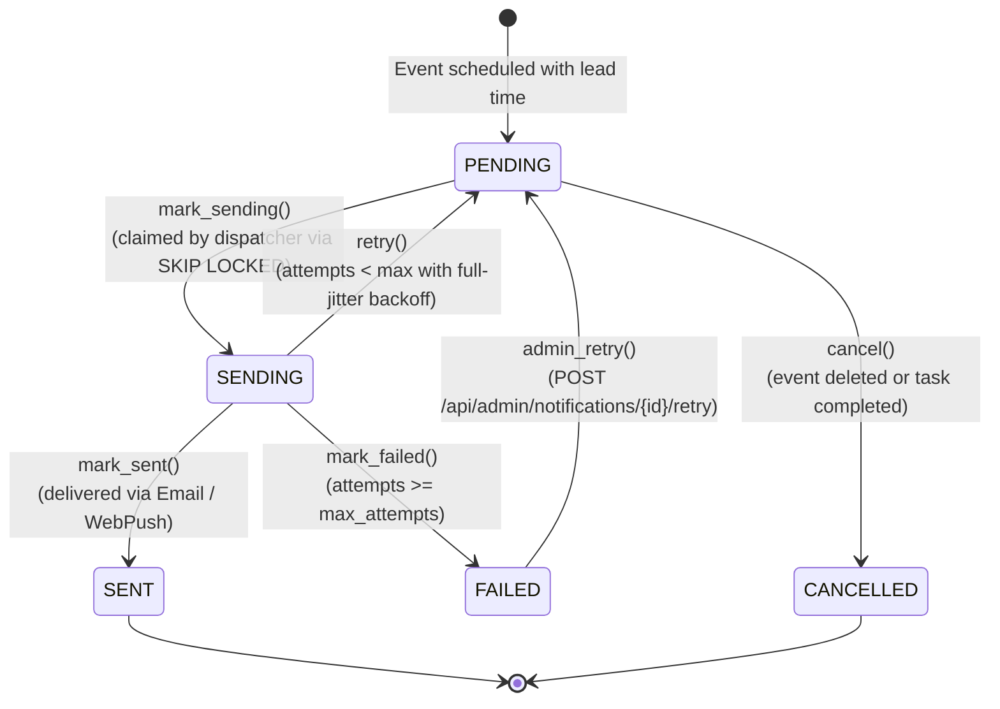

#### 4.3.8 Activity Diagram: Timetable Ingestion & Initials Resolution
*Source: [`docs/diagrams/08-activity-timetable.svg`](docs/diagrams/08-activity-timetable.svg) | [`PNG`](docs/diagrams/08-activity-timetable.png)*

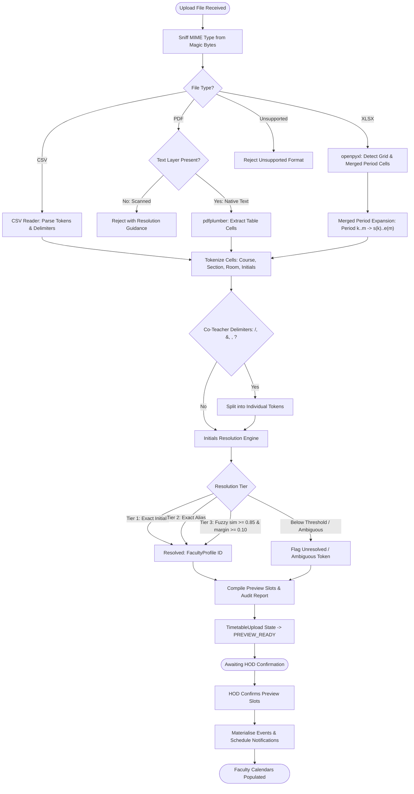

#### 4.3.9 Component Diagram: Clean Architecture & System Layers
*Source: [`docs/diagrams/09-component.svg`](docs/diagrams/09-component.svg) | [`PNG`](docs/diagrams/09-component.png)*

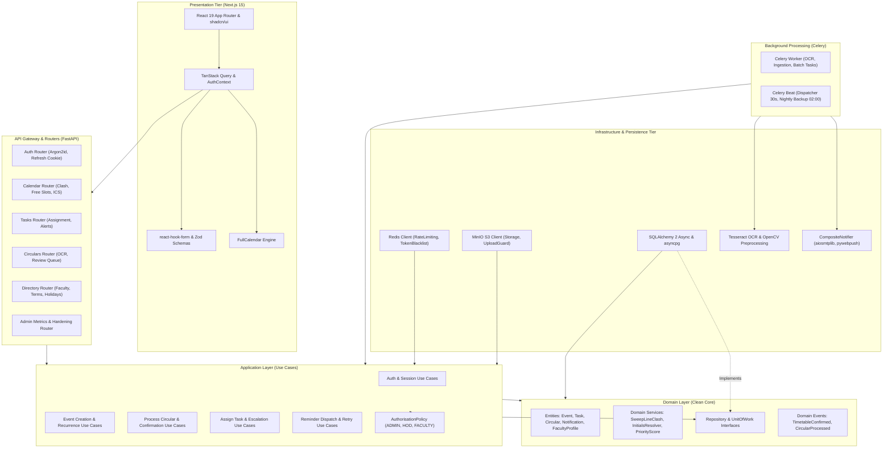

#### 4.3.10 Deployment Diagram: Production & College-LAN Topology
*Source: [`docs/diagrams/10-deployment.svg`](docs/diagrams/10-deployment.svg) | [`PNG`](docs/diagrams/10-deployment.png)*

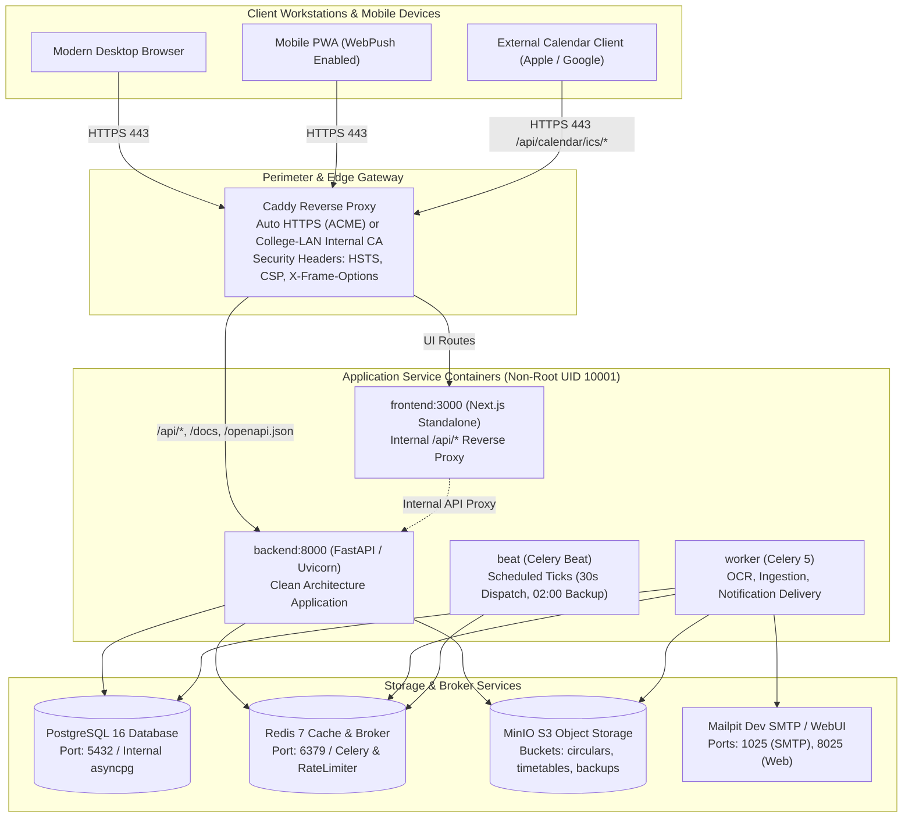

#### 4.3.11 Entity-Relationship (ER) Diagram
*Source: [`docs/diagrams/11-er.svg`](docs/diagrams/11-er.svg) | [`PNG`](docs/diagrams/11-er.png)*

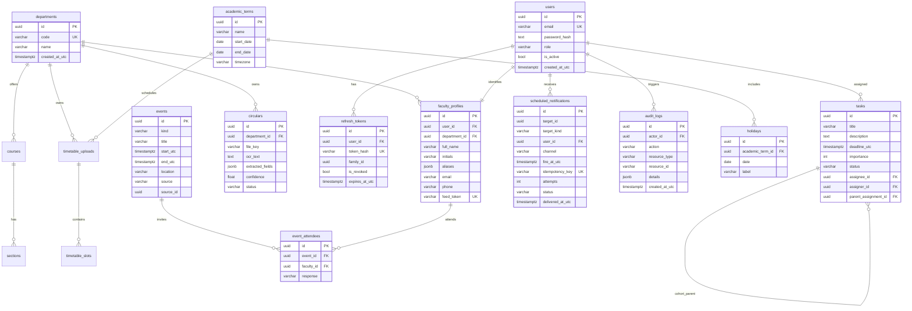


## 5. How to run, test and deploy

### Prerequisites
- Docker & Docker Compose
- `uv` (Python 3.12 package manager)
- `pnpm` (Node package manager)
- Node.js 20+

### Development commands
```bash
# Boot the entire stack in background
make up

# Check status of running containers
docker compose ps

# Run database migrations
make migrate

# Seed synthetic departments, users, term, and holidays
make seed

# Run quality checks (lint, typecheck, targeted tests)
make lint
make typecheck
make test

# Run Playwright E2E smoke tests
cd frontend && pnpm test:e2e

# Prepare fresh environment for live demonstration
make demo

# Tear down environment
make down
```

### Production deployment

FacultyDesk ships with a production-hardened compose definition (`docker-compose.prod.yml`) utilizing:
- Multi-stage non-root containers for both backend (`appuser:10001`) and frontend (`nextjs:10001`).
- Standalone Next.js runner with automatic `/api/*` internal reverse proxy to backend.
- Caddy reverse proxy serving automatic HTTPS with HTTP/2 and HTTP/3 support.
- MinIO S3 object storage with automated bucket provisioning (`create-buckets`).
- Resource limits (`cpus: "2"`, `memory: 2G`) and strict restart policies across all services.

To deploy in production with a public domain:
```bash
# 1. Configure environment variables in .env
DOMAIN=facultydesk.example.edu
CADDY_TLS_DIRECTIVE=acme

# 2. Boot production stack
docker compose -f docker-compose.prod.yml up -d

# 3. Apply database migrations
docker compose -f docker-compose.prod.yml exec backend uv run alembic upgrade head
```

### College-LAN mode (Department Server deployment)

For college intranets or department server labs operating without a public internet domain or public DNS, FacultyDesk supports **College-LAN mode**. Caddy acts as an internal Certificate Authority (CA) issuing locally trusted TLS certificates on LAN IP addresses or internal hostname aliases (e.g. `facultydesk.local` or `192.168.1.100`).

Configuration:
```env
# In .env:
DOMAIN=facultydesk.cse.college.local
CADDY_TLS_DIRECTIVE=internal
```

In `Caddyfile`:
```caddy
{$DOMAIN:localhost} {
    tls {$CADDY_TLS_DIRECTIVE:internal}

    # API and docs routed to backend
    handle /api/* {
        reverse_proxy backend:8000
    }
    handle /docs* {
        reverse_proxy backend:8000
    }
    handle /openapi.json {
        reverse_proxy backend:8000
    }

    # All UI routes handled by Next.js standalone runner
    handle {
        reverse_proxy frontend:3000
    }
}
```

To trust Caddy's internal root CA on faculty workstations connected to the department Wi-Fi/LAN:
1. Fetch root CA certificate: `curl -k https://<server-ip>/caddy-pki-root.crt` or copy `/data/caddy/pki/authorities/local/root.crt` from the Caddy container.
2. Install into OS trust store (macOS Keychain, Windows Trusted Root Authorities, or Linux `/usr/local/share/ca-certificates/`).
3. Department faculty can navigate securely to `https://facultydesk.cse.college.local` with zero browser certificate warnings.

### Service URLs (Dev Mode)
- Frontend: `http://localhost:3000`
- API & Docs: `http://localhost:8000/docs`
- Health Probe: `http://localhost:8000/healthz`
- Readiness Probe: `http://localhost:8000/readyz`
- MinIO Console: `http://localhost:9001`
- Mailpit Web UI: `http://localhost:8025`
