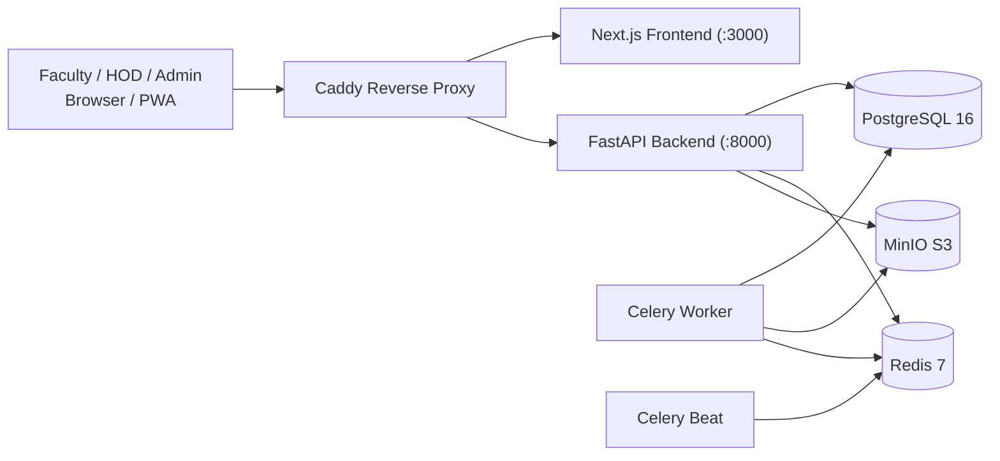
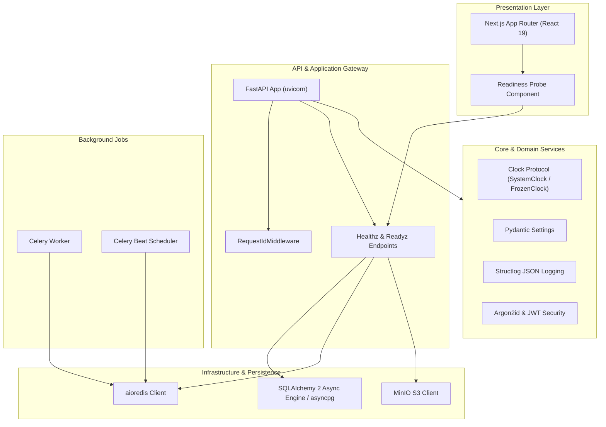

# FacultyDesk

## 1. Problem and users

Faculty juggle classes from a timetable, meetings announced on paper circulars, and documentation deadlines. Today these live in different places and reminders depend on memory. FacultyDesk puts all of it on one calendar and reminds each person at the right time.

| Actor | Goal |
|---|---|
| Admin | Manage departments, faculty directory, terms and holidays |
| HOD | Upload timetables, review circulars, assign documentation tasks, see progress |
| Faculty | See classes and meetings, get reminders, track own tasks |
| Scheduler (system) | Plan and send reminders, refresh calendars nightly |

## 2. Features that exist now

- Monorepo foundation with backend (FastAPI, Python 3.12, SQLAlchemy 2 async, Alembic, Celery, Redis, MinIO) and frontend (Next.js 16 App Router, TypeScript strict, Tailwind, shadcn/ui).
- Injected `Clock` system (`SystemClock`, `FrozenClock`) with mathematical invariants proving canonical UTC handling.
- Structured JSON logging (`structlog`) with distributed request ID tracking (`X-Request-ID`).
- Health probes: `/healthz` (liveness) and `/readyz` (dependency readiness probing PostgreSQL `SELECT 1`, Redis `PING`, and MinIO bucket verification).
- Interactive Frontend dashboard displaying real-time system readiness probe status.
- Docker Compose development and production environments with health checks on all services.
- Knowledge graph indexing with Graphify and verified trusted skills suite.

## 3. Architecture



## 4. OOAD diagrams

### 4.1 Component Diagram



## 5. How to run, test and deploy

### Prerequisites
- Docker & Docker Compose
- `uv` (Python 3.12 package manager)
- `pnpm` (Node package manager)
- Node.js 20+

### Development commands
```bash
# Boot the entire stack in background
make up

# Check status of running containers
docker compose ps

# Run database migrations
make migrate

# Run quality checks (lint, typecheck, targeted tests)
make lint
make typecheck
make test

# Tear down environment
make down
```

### URLs
- Frontend: `http://localhost:3000`
- API & Docs: `http://localhost:8000/docs`
- Health Probe: `http://localhost:8000/healthz`
- Readiness Probe: `http://localhost:8000/readyz`
- MinIO Console: `http://localhost:9001`
