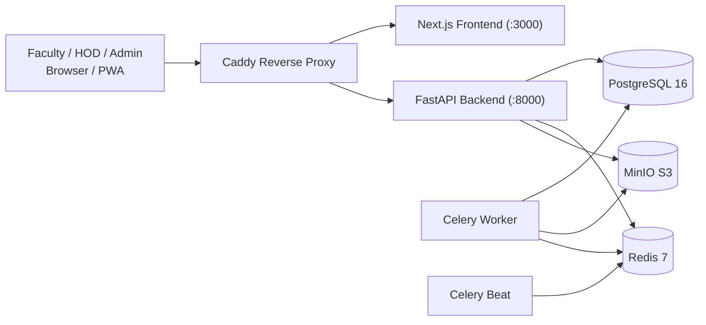
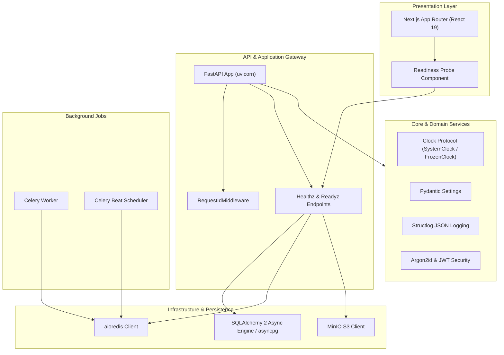
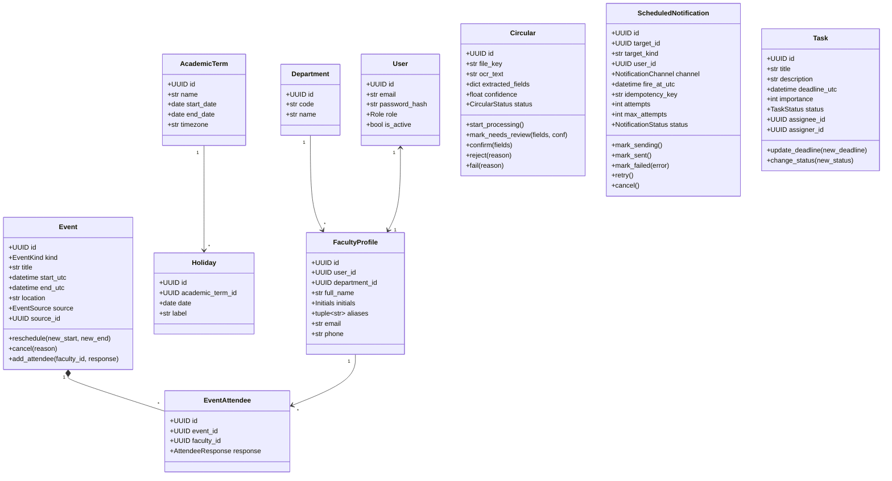
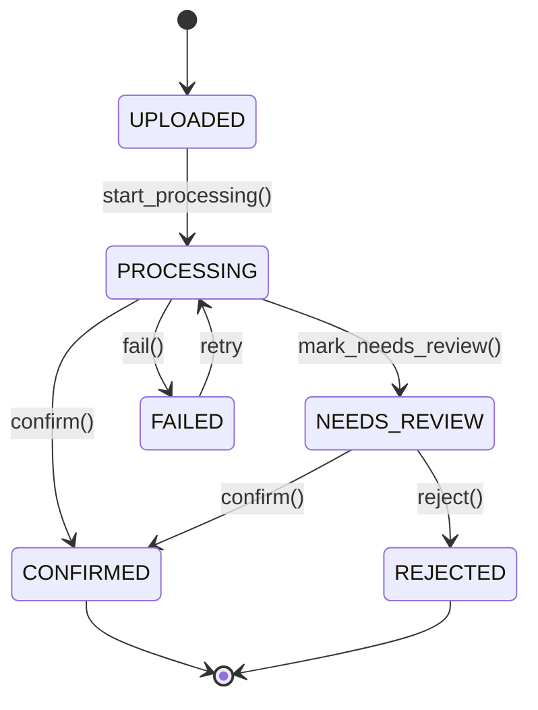
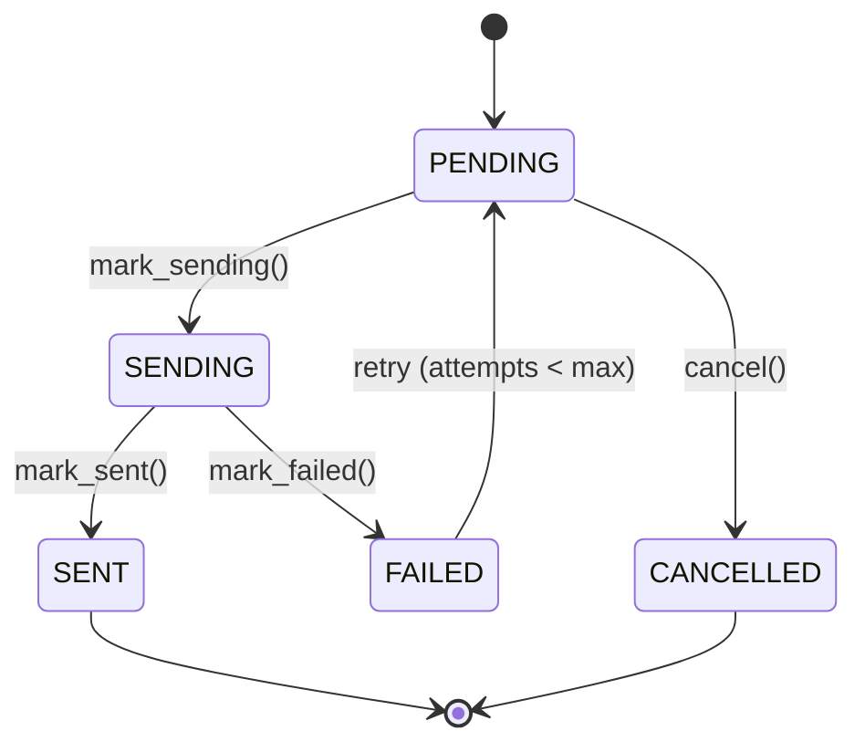
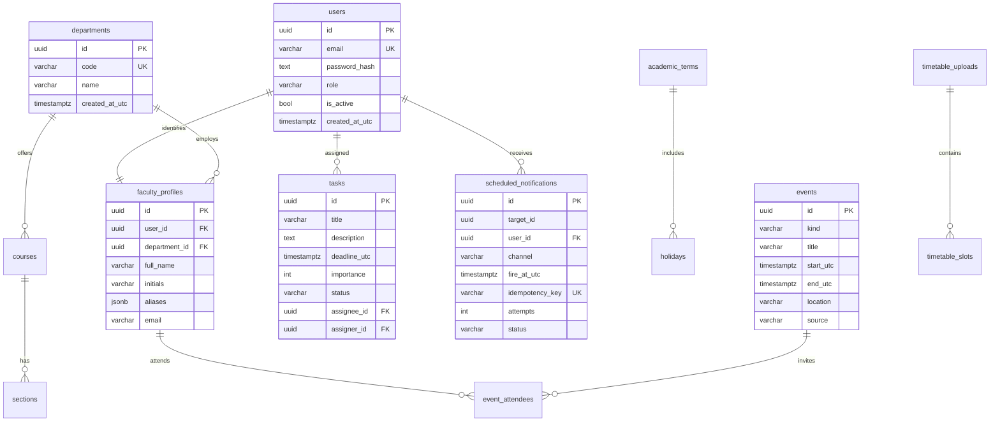
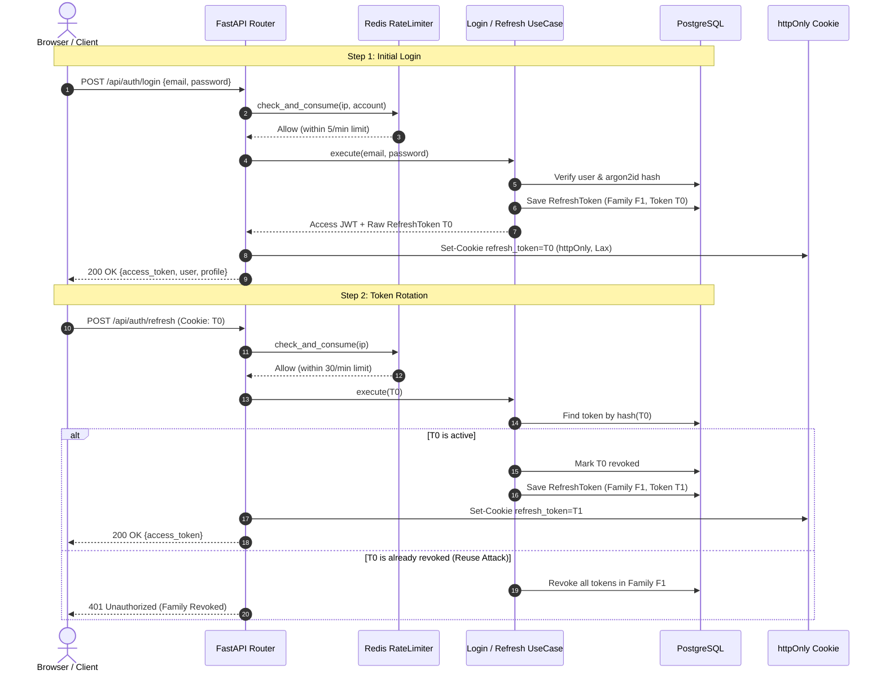
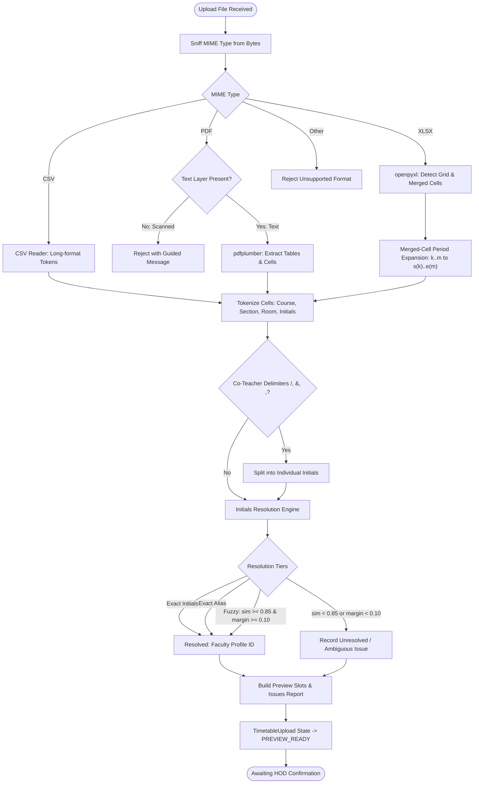
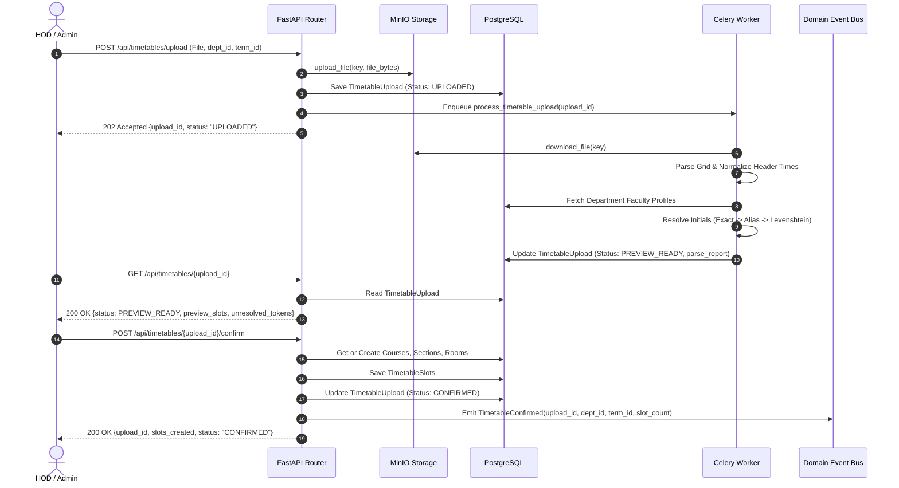

# FacultyDesk

## 1. Problem and users

Faculty juggle classes from a timetable, meetings announced on paper circulars, and documentation deadlines. Today these live in different places and reminders depend on memory. FacultyDesk puts all of it on one calendar and reminds each person at the right time.

| Actor | Goal |
|---|---|
| Admin | Manage departments, faculty directory, terms and holidays |
| HOD | Upload timetables, review circulars, assign documentation tasks, see progress |
| Faculty | See classes and meetings, get reminders, track own tasks |
| Scheduler (system) | Plan and send reminders, refresh calendars nightly |

## 2. Features that exist now

- Monorepo foundation with backend (FastAPI, Python 3.12, SQLAlchemy 2 async, Alembic, Celery, Redis, MinIO) and frontend (Next.js 16 App Router, TypeScript strict, Tailwind, shadcn/ui).
- Injected `Clock` system (`SystemClock`, `FrozenClock`) with mathematical invariants proving canonical UTC handling.
- Structured JSON logging (`structlog`) with distributed request ID tracking (`X-Request-ID`).
- Health probes: `/healthz` (liveness) and `/readyz` (dependency readiness probing PostgreSQL `SELECT 1`, Redis `PING`, and MinIO bucket verification).
- Interactive Frontend dashboard displaying real-time system readiness probe status.
- Framework-free domain layer (`Department`, `User`, `FacultyProfile`, `Initials`, `AcademicTerm`, `Holiday`, `Room`, `Course`, `Section`, `TimetableUpload`, `TimetableSlot`, `Event`, `EventAttendee`, `Circular`, `ScheduledNotification`, `ReminderRule`, `PushSubscription`, `Task`, `AuditLog`, `RefreshToken`).
- Deterministic finite state machines for `Circular` (7 transitions) and `ScheduledNotification` (5 transitions) raising typed `InvalidTransition` on illegal transitions.
- Fully reversible Alembic migrations (`8f3198838ebd_initial_schema.py`, `8434d6a0dd0a_add_refresh_tokens.py`) supporting database schema creation, token rotation, and rollback.
- Async SQLAlchemy repository implementations and `SqlAlchemyUnitOfWork`.
- Authentication system with Argon2id password hashing, 15-minute HS256 access JWTs, and rotating 7-day refresh tokens delivered via httpOnly cookies.
- Refresh token family reuse detection automatically revoking all tokens in a compromised family upon re-presentation.
- Centralized `AuthorisationPolicy` evaluating ownership predicates across `ADMIN`, `HOD`, and `FACULTY` roles.
- Redis-backed Sliding Window Log rate limiter protecting `/api/auth/login` (5/min per IP and account) and `/api/auth/refresh` (30/min per IP).
- Faculty directory management with department CRUD, individual faculty creation/updates, deactivation, and bulk CSV/XLSX import with validation reports.
- Academic calendar terms and holidays management supporting single entry and bulk CSV imports.
- Synthetic database seeder (`make seed`) populating CSE department, Admin, HOD, faculty profiles, academic term, and holidays.
- Multi-format Timetable Ingestion engine supporting XLSX (with merged-cell period expansion), long-format CSV, and text-layer PDF with table extraction.
- Deterministic 3-tier initials resolution (exact initials -> exact alias -> bounded normalized Levenshtein similarity with theta_sim >= 0.85 and theta_margin >= 0.10) preventing false matches.
- Celery worker asynchronous parsing pipeline generating preview slots and detailed unmapped token issue reports.
- Two-phase upload & confirm workflow creating `Course`, `Section`, `Room`, and `TimetableSlot` entities, and emitting `TimetableConfirmed` domain events.
- Rolling 21-day class recurrence materialisation pipeline expanding weekly timetable slots, respecting term boundaries, and skipping academic holidays.
- Sweep-line clash detection algorithm ($O(n \log n)$) evaluating half-open intervals $\max(s_1, s_2) < \min(e_1, e_2)$ across multiple attendees, with explicit override capability returning 409 Conflict with clash details.
- Multi-attendee common free-slot finder detecting non-overlapping working intervals for meeting scheduling.
- RFC 5545 compliant iCalendar (`.ics`) subscription feed with token gating, automatic token rotation, and stable UIDs (`slot-<slot_id>-<date>@facultydesk.local`).
- Celery Beat nightly rolling materialisation task automatically advancing the 21-day window at midnight.
- Docker Compose development and production environments with health checks on all services.
- Knowledge graph indexing with Graphify and verified trusted skills suite.

## 3. Architecture



## 4. OOAD diagrams

### 4.1 Component Diagram



### 4.2 Domain Class Diagram



### 4.3 Circular State Machine



### 4.4 ScheduledNotification State Machine



### 4.5 Entity-Relationship (ER) Diagram



### 4.6 Authentication & Token Rotation Sequence



### 4.7 Timetable Ingestion Activity Diagram



### 4.8 Timetable Upload to Confirmation Sequence



### 4.9 Calendar Recurrence Materialisation and Sweep-Line Clash Detection

```mermaid
sequenceDiagram
    autonumber
    actor User as Faculty / HOD / Admin
    participant API as FastAPI Router
    participant UC as Calendar UseCases
    participant Clash as SweepLineClashDetector
    participant DB as PostgreSQL
    participant Ext as External Calendar (Apple/Google)

    Note over User, DB: Scenario 1: Meeting Creation with Clash Detection
    User->>API: POST /api/calendar/events {title, start, end, attendees, override: false}
    API->>UC: CreateEventUseCase.execute(...)
    UC->>DB: Fetch existing attendee events in [start, end)
    UC->>Clash: detect_clashes(new_event, existing_events)
    alt Overlap Detected: max(s1, s2) < min(e1, e2)
        Clash-->>UC: Clashes list [attendee_id, title, start, end]
        UC-->>API: raise ClashDetectedError(clashes)
        API-->>User: 409 Conflict {message, clashes}
    else No Overlap or override=true
        UC->>DB: Save Event + EventAttendees
        DB-->>UC: event
        UC-->>API: event
        API-->>User: 201 Created {event_id, title, start_utc, end_utc}
    end

    Note over User, Ext: Scenario 2: Token-Gated RFC 5545 ICS Feed Sync
    Ext->>API: GET /api/calendar/ics/{feed_token}.ics
    API->>UC: GenerateIcsFeedUseCase.execute(feed_token)
    UC->>DB: Look up FacultyProfile by feed_token
    UC->>DB: Query attendee events for faculty in window
    UC->>UC: Generate VCALENDAR with stable UIDs & PRODID
    UC-->>API: VCALENDAR text/calendar payload
    API-->>Ext: 200 OK text/calendar; charset=utf-8
```

## 5. How to run, test and deploy

### Prerequisites
- Docker & Docker Compose
- `uv` (Python 3.12 package manager)
- `pnpm` (Node package manager)
- Node.js 20+

### Development commands
```bash
# Boot the entire stack in background
make up

# Check status of running containers
docker compose ps

# Run database migrations
make migrate

# Seed synthetic departments, users, term, and holidays
make seed

# Run quality checks (lint, typecheck, targeted tests)
make lint
make typecheck
make test

# Tear down environment
make down
```

### URLs
- Frontend: `http://localhost:3000`
- API & Docs: `http://localhost:8000/docs`
- Health Probe: `http://localhost:8000/healthz`
- Readiness Probe: `http://localhost:8000/readyz`
- MinIO Console: `http://localhost:9001`
